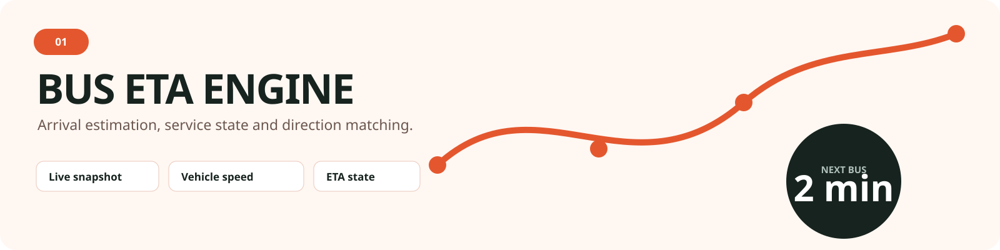
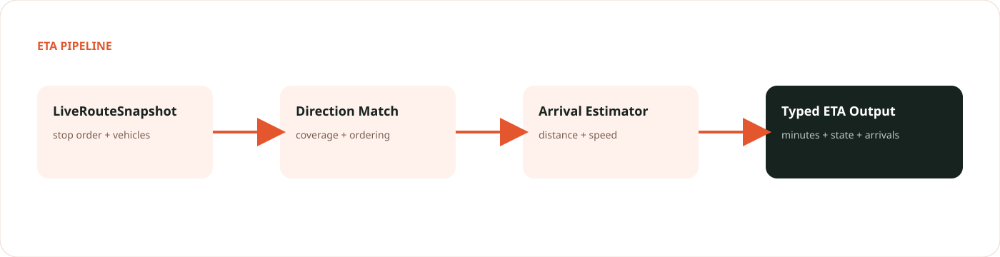
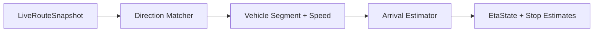

# 🚌 Bus ETA Engine

<p align="center">
  
</p>

<p align="right">
  <a href="./README.md">繁體中文</a> · <strong>English</strong> ·
  <a href="../README.en.md">Project Home</a>
</p>

<p>
  <kbd>TypeScript</kbd>
  <kbd>ETA</kbd>
  <kbd>Live Snapshot</kbd>
  <kbd>Direction Matching</kbd>
  <kbd>Boundary Tested</kbd>
  <kbd>Apache-2.0</kbd>
</p>

## 🧭 Contents

- [Problem](#what-problem-does-it-solve)
- [Features and API](#main-api)
- [Pipeline](#eta-pipeline)
- [Quick Start](#quick-start)
- [Complete Example](#complete-example)
- [Custom DataProvider](#custom-dataprovider)
- [Edge Cases](#edge-cases)
- [Integration Recipes](#integration-recipes)
- [Tests](#tests)
- [Troubleshooting](#troubleshooting)
- [FAQ](#faq)
- [Roadmap](#roadmap)
- [Security](#security)
- [License](#license)

> **Turn vehicle observations, speed, and local stop order into arrivals, countdown states, and downstream ETA estimates.**

## What Problem Does It Solve?

Bus ETA data usually breaks at the edges:

1. Arrival payloads contain duplicate, negative, non-numeric, or extreme minutes.
2. Live stop order does not perfectly match local direction data.
3. A vehicle may be stationary or the snapshot may be stale.
4. UI code ends up owning parsing, matching, countdown, and presentation at once.

This package separates those concerns into deterministic functions and explicit domain errors.

## Feature Overview

| Capability | Export | Result |
| --- | --- | --- |
| ETA payload cleaning | `parseEtaPayload` | `EtaSnapshot` |
| Live payload normalization | `parseLiveRouteSnapshot` | `LiveRouteSnapshot` |
| Countdown state | `deriveEtaState` | `EtaState` |
| Vehicle-to-stop estimation | `estimateStopArrivals` | `StopArrivalEstimate[]` |
| Direction matching | `matchRouteDirection` | `DirectionMatch \| null` |
| Stop normalization | `normalizeStopCode` | canonical station code |
| LRT headway helper | `calculateLrtSchedule` | `LrtArrivalSchedule \| null` |

## 📊 At a Glance

| Metric | Value |
| --- | ---: |
| Test files | 2 |
| Unit tests in package | 16 |
| External network calls | 0 |
| Supported states | 5 |
| Default dependency | Provider layer |

## 🔄 ETA Pipeline

<p align="center">
  
</p>



## 🚀 Quick Start

```powershell
npm run build -w @onedirect/bus-eta-engine
npm run test -w @onedirect/bus-eta-engine
```

All tests run against `MockDataProvider`.

## 🔌 Main API

### `parseEtaPayload(payload: unknown)`

The parser trims identifiers, validates dates, sorts and deduplicates arrivals, and drops invalid values.

### `deriveEtaState(snapshot, options?)`

| State | Condition |
| --- | --- |
| `arriving` | adjusted minutes = `0` |
| `approaching` | `1–2` minutes |
| `scheduled` | `> 2` minutes |
| `stale` | age exceeds threshold |
| `unavailable` | no arrivals |

Options:

- `now?: Date`
- `staleAfterSeconds?: number`, default `120`

### `estimateStopArrivals(direction, liveStops, options?)`

The estimator:

1. Normalizes live stop codes.
2. Maps each live stop to a local route index.
3. Calculates Haversine distance between stops.
4. Uses vehicle segment, half-segment offset, and speed.
5. Skips vehicles with speed `<= 0`.
6. Keeps a bounded number of arrivals per stop.

### `matchRouteDirection(route, liveStops, options?)`

Direction scoring considers exact codes, names, index offsets, and coverage. If coverage is insufficient, it returns `null` instead of guessing.

## 🧵 Complete Example

```ts
import { MockDataProvider } from "@onedirect/data-fetcher-provider-layer";
import {
  estimateSnapshotArrivals,
  matchLiveRoute,
} from "@onedirect/bus-eta-engine";

const provider = new MockDataProvider();
const route = await provider.getRoute("B12");
const live = await provider.getLiveRoute("B12", 0);

if (route && live) {
  const match = matchLiveRoute(route, live);
  if (match) {
    const direction = route.directions[match.directionIndex]!;
    console.log(estimateSnapshotArrivals(direction, live));
  }
}
```

## 🔌 Custom DataProvider

```ts
import { MockDataProvider } from "@onedirect/data-fetcher-provider-layer";

class HostEtaProvider extends MockDataProvider {
  readonly id = "host-eta";

  override getLiveRoute(routeId: string, direction: number | null = null) {
    return this.hostClient.readLiveRoute(routeId, direction);
  }
}
```

The host owns authentication, timeouts, retries, and payload mapping.

## 🧱 Edge Cases

- Duplicate minute values are deduplicated.
- Arrival minutes are limited to `360`.
- Stationary vehicles produce no estimate.
- A vehicle must be before the target stop.
- Invalid coordinates cannot create a false estimate.
- Stale data is represented explicitly.

## ✅ Tests

Coverage includes zero-minute boundaries, stale data, duplicate arrivals, ordered and reversed directions, code normalization, stationary vehicles, and downstream arrival estimation.

## 🔒 Security

- No real endpoints, headers, cookies, or scraper logic.
- No production live payloads in fixtures.
- No logging of private vehicle or user locations.

## 🤖 AI Collaboration

Read [AGENTS.md](./AGENTS.md) before changing the package.

## ✅ When to Use It

- You already have local route directions and live vehicle observations.
- You need explicit arrival, approaching, scheduled, stale, and unavailable states.
- You want direction matching to fail safely instead of showing a wrong ETA.
- You need deterministic tests with fixed clocks and fixtures.

## 🚫 When Not to Use It

- The task requires scraping a dynamic website.
- The task needs provider authentication or upstream retries.
- The task is full origin-to-destination navigation.
- The task is map rendering or bottom-sheet UI.

## 📦 Data Contracts

The package consumes shared contracts from `02-data-fetcher-provider-layer`: routes, route directions, live snapshots, stop observations, ETA snapshots, and arrival estimates.

## 🍳 Integration Recipes

### React ETA Display

Compute `deriveEtaState` in a selector or hook, then render the returned state and minutes. Avoid recalculating or refetching the same snapshot on every render.

### Route Detail

Load the local route, select a direction, load the matching live snapshot, run matching, generate stop estimates, and pass the typed results to the UI.

### Nearby Route Card

Calculate only the selected stop instead of preparing presentation data for the whole route.

## 🎯 Determinism

- Earth radius is fixed.
- Minute calculations use `Math.ceil`.
- Vehicles sort by minutes and then ID.
- Direction candidates sort by score and index.
- Schedule calculations accept an explicit UTC offset.

## ⚡ Performance

Runtime is proportional to stop count and vehicle count. Typical urban routes are small. For larger networks, filter routes and directions before estimation and cache provider results in `02` or the host.

## 🧯 Troubleshooting

### Every arrival is unavailable

Validate `generatedAt`, ensure arrivals are finite and non-negative, and confirm the provider shape.

### Direction matching always fails

Check stop suffixes, local order, and coverage. Do not lower the threshold merely to force a result.

### ETA is always null

Check that speed is positive and the target stop is ahead of the vehicle segment.

### Data becomes stale too quickly

Adjust `staleAfterSeconds` deliberately. Do not hide stale data behind an extreme threshold.

## ❓ FAQ

### Can I use only `deriveEtaState`?

Yes. Provide a valid `EtaSnapshot`.

### Can I use another speed source?

Yes, but preserve source and fallback metadata so derived ETA is not mistaken for direct realtime data.

### Does it support circular routes?

Circular behavior must be represented correctly in provider directions.

## 🗺️ Roadmap

- Configurable speed profiles.
- Arrival confidence metadata.
- Circular-route fixtures.
- Long-route benchmarks.

## 📄 License

Apache-2.0. See [LICENSE](../LICENSE).

---

<p align="center"><a href="#">Back to top</a></p>
