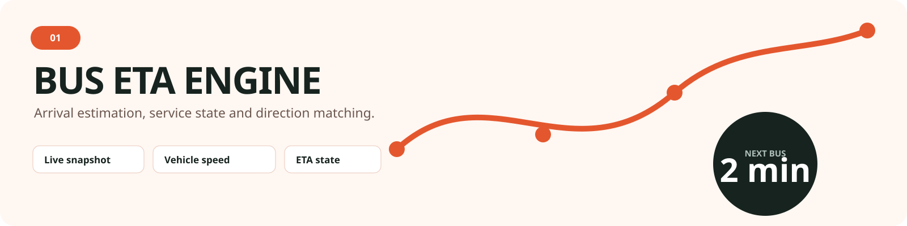
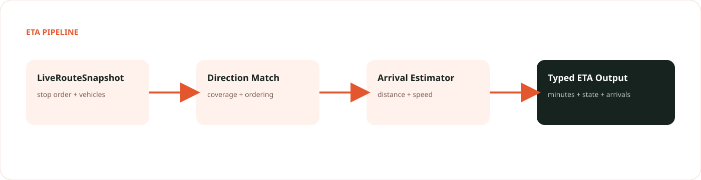
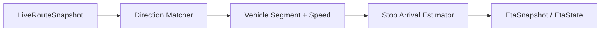

# 01 · Bus ETA Engine

<p align="center">
  
</p>

<p>
  <kbd>ETA</kbd>
  <kbd>Live Snapshot</kbd>
  <kbd>Direction Matching</kbd>
  <kbd>Boundary Tests</kbd>
</p>

> **把即時車輛位置、速度和路線站序轉成可顯示的到站時間、倒數狀態及下游站點 ETA。**

## 功能

<p align="center">
  
</p>

- 清洗 ETA payload、剔除重複及不合理 arrival。
- 計算 `arriving`、`approaching`、`scheduled`、`stale`、`unavailable`。
- 依 vehicle segment、speed 及站點距離估算下游站點。
- 比對 live stop order 與本地 route direction。
- 支援輕軌 headway schedule 作為輔助時間計算。



## 快速開始

```powershell
npm run build -w @onedirect/bus-eta-engine
npm run test -w @onedirect/bus-eta-engine
```

## 核心 API

| Export | 用途 |
| --- | --- |
| `parseEtaPayload` | 清洗 `unknown` ETA payload |
| `deriveEtaState` | 計算倒數與資料狀態 |
| `parseLiveRouteSnapshot` | 正規化站序與車輛 observations |
| `estimateStopArrivals` | 依 route direction 與 live stops 計算下游 ETA |
| `estimateSnapshotArrivals` | 上述函數的 snapshot wrapper |
| `matchRouteDirection` | 比對 stop order 與所有 local directions |
| `matchLiveRoute` | 同時檢查 route ID 及 direction |
| `findMatchingStop` | 以 code／name 找回 local stop |
| `calculateLrtSchedule` | Headway schedule helper |

## 使用範例

```ts
import { MockDataProvider } from "@onedirect/data-fetcher-provider-layer";
import {
  estimateSnapshotArrivals,
  matchLiveRoute,
} from "@onedirect/bus-eta-engine";

const provider = new MockDataProvider();
const route = await provider.getRoute("B12");
const live = await provider.getLiveRoute("B12", 0);

if (route && live) {
  const match = matchLiveRoute(route, live);
  if (match) {
    const direction = route.directions[match.directionIndex]!;
    const estimates = estimateSnapshotArrivals(direction, live);
    console.log(estimates);
  }
}
```

## Custom `DataProvider`

Bus ETA Engine 只依賴 `@onedirect/data-fetcher-provider-layer` 的 public contracts。宿主應用替換 provider 即可接入真實資料：

```ts
import { MockDataProvider } from "@onedirect/data-fetcher-provider-layer";

class HostProvider extends MockDataProvider {
  readonly id = "host-eta";

  override getLiveRoute(routeId: string, direction: number | null = null) {
    return this.hostLiveClient.read(routeId, direction);
  }
}
```

> 不要把 upstream endpoint、auth headers、token 或爬蟲 selector 寫進 Bus ETA Engine。

## AI 協作

修改 ETA、匹配或邊界條件前，先閱讀 [`AGENTS.md`](./AGENTS.md)。
