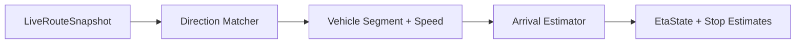

# 🚌 Bus ETA Engine

<p align="center">
  
</p>

<p align="right">
  <strong>繁體中文</strong> · <a href="./README.en.md">English</a> ·
  <a href="../README.md">專案首頁</a>
</p>

<p>
  <kbd>TypeScript</kbd>
  <kbd>ETA</kbd>
  <kbd>Live Snapshot</kbd>
  <kbd>Direction Matching</kbd>
  <kbd>Boundary Tested</kbd>
  <kbd>Apache-2.0</kbd>
</p>

## 🧭 目錄

- [問題背景](#這個模組解決什麼問題)
- [功能與 API](#主要-api)
- [ETA Pipeline](#eta-pipeline)
- [Quick Start](#quick-start)
- [完整範例](#完整使用範例)
- [Custom DataProvider](#custom-dataprovider)
- [Edge Cases](#edge-cases)
- [Integration Recipes](#integration-recipes)
- [Tests](#測試)
- [Troubleshooting](#troubleshooting)
- [FAQ](#faq)
- [Roadmap](#roadmap)
- [Security](#安全邊界)
- [License](#license)

> **把車輛位置、速度及站序轉成可顯示的到站時間、倒數狀態與 downstream ETA。**

## 🧩 這個模組解決什麼問題？

Bus ETA 資料通常有四類風險：

1. Arrival payload 含重複、負數、非數字或過大的 minutes。
2. Live data 的站序與本地方向資料不完全一致。
3. 車輛可能停低、速度為零，或資料已經過期。
4. UI 同時處理 parsing、matching、倒數與顯示，令邊界情況難以測試。

此 package 將上述工作拆成 pure functions 與明確 domain errors，不直接連任何 transit API。

## ✨ 功能一覽

| 能力 | Export | 結果 |
| --- | --- | --- |
| ETA payload cleaning | `parseEtaPayload` | `EtaSnapshot` |
| Live payload normalization | `parseLiveRouteSnapshot` | `LiveRouteSnapshot` |
| Countdown state | `deriveEtaState` | `EtaState` |
| Vehicle-to-stop estimation | `estimateStopArrivals` | `StopArrivalEstimate[]` |
| Direction matching | `matchRouteDirection` | `DirectionMatch \| null` |
| Stop normalization | `normalizeStopCode` | canonical station code |
| LRT headway helper | `calculateLrtSchedule` | `LrtArrivalSchedule \| null` |

## 📊 At a Glance

| Metric | Value |
| --- | ---: |
| Test files | 2 |
| Unit tests in package | 16 |
| External network calls | 0 |
| Supported states | 5 |
| Default dependency | Provider layer |

## 🔄 ETA Pipeline

<p align="center">
  
</p>



## 🚀 Quick Start

```powershell
npm run build -w @onedirect/bus-eta-engine
npm run test -w @onedirect/bus-eta-engine
```

package 使用 `MockDataProvider` 進行 tests，不需要 credentials。

## 🔌 主要 API

### `parseEtaPayload(payload: unknown)`

| 輸入 | 行為 | 錯誤 |
| --- | --- | --- |
| ETA object | Trim IDs、驗證日期、sort／dedupe arrivals | `EtaParseError` |
| Direction 0／1 | 保留方向 | Invalid route／date 會失敗 |
| Arrival list | 移除負數、NaN 與過大值 | 空 arrivals 可接受 |

### `deriveEtaState(snapshot, options?)`

| State | 條件 |
| --- | --- |
| `arriving` | 調整後 minutes = `0` |
| `approaching` | `1–2` minutes |
| `scheduled` | `> 2` minutes |
| `stale` | Data age 超過 threshold |
| `unavailable` | 沒有 arrivals |

`options`：

- `now?: Date`
- `staleAfterSeconds?: number`，預設 `120`

### `estimateStopArrivals(direction, liveStops, options?)`

計算方式：

1. 正規化 live stop code。
2. 將 live stop 對應到本地 route index。
3. 計算站與站之間 Haversine 距離。
4. 依 vehicle segment、半速度 offset 及 speed 計算 remaining minutes。
5. 過濾速度 `<= 0` 的車輛。
6. 每個站最多保留 `maxArrivalsPerStop` 個 arrivals。

```ts
type StopArrivalEstimate = {
  routeStopIndex: number;
  stopId: string;
  stopCode: string;
  name: string;
  estimateMinutes: number | null;
  arrivals: Array<{
    minutes: number;
    vehicleId: string;
    speedKmh: number;
  }>;
};
```

### `matchRouteDirection(route, liveStops, options?)`

Direction matcher 同時考慮：

- 完全站碼匹配。
- 名稱匹配。
- 站序 index offset。
- Coverage threshold。

預設 `minCoverage = 0.5`、`maxIndexOffset = 3`。匹配不足時回傳 `null`，不會強制選第一個方向。

## 🧵 完整使用範例

```ts
import { MockDataProvider } from "@onedirect/data-fetcher-provider-layer";
import {
  estimateSnapshotArrivals,
  matchLiveRoute,
  parseEtaPayload,
  deriveEtaState,
} from "@onedirect/bus-eta-engine";

const provider = new MockDataProvider();
const route = await provider.getRoute("B12");
const live = await provider.getLiveRoute("B12", 0);

if (route && live) {
  const match = matchLiveRoute(route, live);
  if (match) {
    const direction = route.directions[match.directionIndex]!;
    const estimates = estimateSnapshotArrivals(direction, live);
    const target = estimates.find((item) => item.stopId === "BUS-04")!;

    const snapshot = parseEtaPayload({
      routeId: route.id,
      stopId: target.stopId,
      direction: match.directionIndex,
      generatedAt: live.observedAt,
      arrivals: target.arrivals,
      source: "mock",
    });

    console.log(deriveEtaState(snapshot, {
      now: new Date(live.observedAt),
    }));
  }
}
```

## 🔌 Custom DataProvider

```ts
import { MockDataProvider } from "@onedirect/data-fetcher-provider-layer";

class HostEtaProvider extends MockDataProvider {
  readonly id = "host-eta";

  override getLiveRoute(routeId: string, direction: number | null = null) {
    return this.hostClient.readLiveRoute(routeId, direction);
  }
}
```

Host provider 負責 auth、timeout、retry 及 vendor payload mapping。Bus ETA Engine 只接收 normalized contracts。

## 🧱 Edge Cases

- 同一 arrival minutes 只保留第一個合法值。
- Arrival minutes 上限為 `360`。
- `speedKmh = 0` 不產生 estimate。
- Vehicle segment 必須早於 target stop。
- Invalid coordinate 會被視為無限距離，不會產生虛假 ETA。
- 舊資料會由 `stale` state 明確表示。

## ✅ 測試

```powershell
npm run test -w @onedirect/bus-eta-engine
```

覆蓋：

- Zero-minute boundary。
- Stale 與 unavailable states。
- Duplicate／invalid arrivals。
- Ordered／reversed direction。
- Lane suffix 與 hyphen-in-code。
- Stationary vehicle。
- Downstream arrival estimation。

## 🔒 安全邊界

- 不加入真實 endpoint、headers、cookies 或 scraper。
- 不接受 production live payload 作 fixture。
- 不記錄 vehicle 或 user 的私人位置。

## 🤖 AI 協作

修改前先閱讀 [AGENTS.md](./AGENTS.md)。

## ✅ 何時適合使用

- 你的 app 已有 route directions，但需要把 live vehicle observations 轉成到站時間。
- 你需要在 UI 顯示 arriving／approaching／scheduled／stale。
- 你需要把方向匹配失敗明確變成 error，而不是顯示錯誤 ETA。
- 你想用固定 clock 為時間邏輯建立 deterministic tests。

## 🚫 何時不應使用

- 需要直接 scrape 動態網頁。
- 需要管理 provider authentication 或 upstream retry。
- 需要計算完整 A 到 B journey。
- 需要渲染 map 或 bottom sheet。

## 📦 Data Contracts

| Contract | 重要欄位 |
| --- | --- |
| `TransitRoute` | `directions[]`、route metadata |
| `RouteDirection` | `stops[]`、index、name |
| `LiveRouteSnapshot` | route、direction、observedAt、stops |
| `LiveStopObservation` | stop code、vehicles |
| `EtaSnapshot` | generatedAt、arrivals、source |
| `StopArrivalEstimate` | stop、minutes、vehicle arrivals |

以上 contracts 全部由 `02-data-fetcher-provider-layer` 提供。

## 🍳 Integration Recipes

### React 顯示 ETA

```tsx
const state = deriveEtaState(snapshot, { now: new Date() });

return (
  <span data-state={state.state}>
    {state.minutes ?? "—"} min
  </span>
);
```

### Route Detail

1. 以 route ID 取得 local route。
2. 以 selected direction 取得 live snapshot。
3. 執行 direction matching。
4. 產生全部 stop estimates。
5. UI 只 render typed output。

### Nearby Route Card

只需要 selected stop estimate，不需預先計算整條路線的 presentation。

## 🎯 Determinism

- `distanceInMeters` 使用固定地球半徑。
- Arrival minutes 使用 `Math.ceil`。
- Vehicles 依 minutes、vehicle ID 排序。
- Direction candidate 使用 score 及 direction index tie-break。
- Schedule 明確傳入 UTC offset。

## ⚡ 效能

此 package 的計算量與 route stops 及 vehicle count 成正比。一般市區路線不會構成壓力。

建議：

- 不要為每次 render 重新 fetch live snapshot。
- Provider caching 應在 `02` 或 host 實作。
- 只在需要時計算 selected route。
- 若 route network 很大，先 filter route／direction。

## 🧯 Troubleshooting

### 所有 arrivals 都變成 unavailable

確認 `generatedAt` 合法、arrivals 不是負數或超過上限，並確認 provider 回傳的是 expected shape。

### Direction 永遠 match 不到

檢查 stop code suffix、route data 順序及 `minCoverage`。若 coverage 真的不足，不應降低 threshold 來強行顯示。

### ETA 一直是 null

檢查 vehicle speed 是否大於零，以及 target stop 是否在 vehicle segment 之後。

### Stale state 太早出現

調整 `staleAfterSeconds`，但不要用極長時間隱藏資料過期。

## ❓ FAQ

### 可以只用 `deriveEtaState` 嗎？

可以，但你需要提供符合 `EtaSnapshot` 的 typed input。

### 可以改用 average speed 嗎？

可以，但應保留 speed source 與 fallback reason，避免 ETA 看似 realtime。

### 為何不用 straight-line distance 作唯一估算？

此模組以 stop-to-stop geographic distance 作 deterministic baseline；更高準確度幾何應由 host 提供。

### 是否支援 circular route？

目前以 directional stop order 處理；circular 行為應由 provider 正確建立 directions。

## 🗺️ Roadmap

- [ ] Add configurable speed profiles.
- [ ] Add richer arrival confidence metadata.
- [ ] Add circular-route test fixtures.
- [ ] Add benchmark cases for long routes.

## 📚 延伸閱讀

- [Provider Layer](../02-data-fetcher-provider-layer/README.md)
- [English version](./README.en.md)
- [Security Policy](../SECURITY.md)

## 📄 License

Apache-2.0，詳見 [LICENSE](../LICENSE)。

---

<p align="center"><a href="#">Back to top</a></p>
