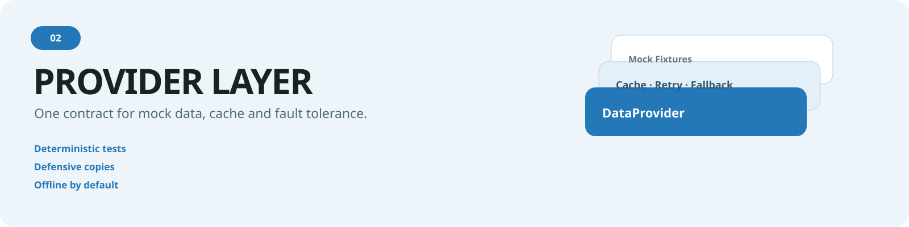
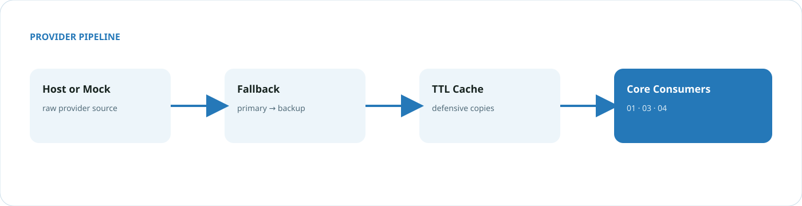

# 🔌 Data Fetcher & Provider Layer

<p align="center">
  
</p>

<p align="right">
  <a href="./README.md">繁體中文</a> · <strong>English</strong> ·
  <a href="../README.en.md">Project Home</a>
</p>

<p>
  <kbd>DataProvider</kbd>
  <kbd>Mock Data</kbd>
  <kbd>TTL Cache</kbd>
  <kbd>Retry</kbd>
  <kbd>Fallback</kbd>
  <kbd>Apache-2.0</kbd>
</p>

## 🧭 Contents

- [Why a Provider Layer](#why-a-provider-layer)
- [DataProvider Contract](#dataprovider-contract)
- [Mock and Provider Stack](#mockdataprovider)
- [Cache and Retry](#cache)
- [Fallback](#fallback)
- [Quick Start](#quick-start)
- [Custom DataProvider](#custom-dataprovider)
- [Integration Patterns](#integration-patterns)
- [Troubleshooting](#troubleshooting)
- [FAQ](#faq)
- [Roadmap](#roadmap)
- [License](#license)

> **The shared data boundary for every core module: contracts, mock data, cache, retry, fallback, and fault tolerance.**

## 🧩 Why a Provider Layer?

Without a shared boundary, ETA, search, and navigation duplicate HTTP handling, caching, authentication, and vendor-specific mapping. This package isolates all data access behind one contract.

| Without It | With It |
| --- | --- |
| Every module calls APIs | One `DataProvider` contract |
| Tests need network access | Default `MockDataProvider` |
| Secrets spread across code | Host-owned configuration |
| Retry logic is duplicated | Reusable `withRetry` |
| Cache behavior differs | `TtlCache` and `CachedDataProvider` |
| Primary failure stops the app | Explicit fallback provider |

## ✨ Features

<p align="center">
  
</p>

| Feature | Implementation |
| --- | --- |
| Shared contracts | Transit, ETA, LRT, walking path, route geometry |
| Mock data | Fictional routes, stops, live snapshots, schedules |
| Cache | Generic TTL cache and provider wrapper |
| Retry | Exponential retry helper |
| Fault tolerance | Primary-to-fallback delegation |
| Defensive output | `structuredClone` for mock and cache data |

## 📊 At a Glance

| Metric | Value |
| --- | ---: |
| Provider methods | 10 |
| Mock JSON files | 8 |
| Unit tests in package | 8 |
| Network calls by default | 0 |
| Runtime dependencies | 0 |

## 🚀 Quick Start

```powershell
npm run build -w @onedirect/data-fetcher-provider-layer
npm run test -w @onedirect/data-fetcher-provider-layer
```

## 📦 DataProvider Contract

The interface covers routes, a single route, stops, LRT lines and stations, route geometry, live snapshots, LRT schedules, walking paths, and reload.

Consumers must depend on this contract rather than `fetch`, database SDKs, or vendor response types.

## 🧪 MockDataProvider

```ts
import { MockDataProvider } from "@onedirect/data-fetcher-provider-layer";

const provider = new MockDataProvider(150);
const routes = await provider.getRoutes();
```

The optional constructor value simulates latency. Returned data is cloned so consumers cannot mutate the source fixtures.

## Provider Stack

```ts
import {
  CachedDataProvider,
  FallbackDataProvider,
  MockDataProvider,
} from "@onedirect/data-fetcher-provider-layer";

const provider = new CachedDataProvider(
  new FallbackDataProvider(
    new MockDataProvider(),
    new MockDataProvider(5),
  ),
  30_000,
);
```

## 🗃️ Cache

`TtlCache` provides a generic key-value cache with TTL validation, bounded size, stale reads, and an injectable clock.

`CachedDataProvider` wraps every provider method and clears its cache on `reload()`.

## 🔁 Retry

`withRetry` supports:

- Maximum attempts.
- Exponential delay.
- Maximum delay.
- Custom retry predicate.
- Injected sleeper for deterministic tests.

## 🛡️ Fallback

`FallbackDataProvider` delegates every method independently and records successful sources through `activeSources()`.

## 🧪 Mock Fixtures

The package ships eight fictional datasets covering routes, stops, LRT lines and stations, live observations, schedules, geometries, and walking paths.

## 🔌 Custom DataProvider

Implement the provider in the host application and map all vendor responses into shared contracts. Authentication, timeout handling, backend retries, cache invalidation, and secrets remain host responsibilities.

## 🧱 Error and Data Rules

- Never leak vendor payloads through the provider boundary.
- Do not convert transient failures into empty arrays.
- Do not return mutable shared cache objects.
- Preserve useful error context when fallback also fails.
- Never retry indefinitely.

## ✅ Tests

Tests cover defensive copies, geometry, TTL expiry, retry delay, fallback, and cache invalidation on reload.

## 🔒 Security

- Fixtures must remain fictional.
- No real endpoints, tokens, cookies, headers, signatures, or production payloads.
- Logs must not contain credentials or complete upstream bodies.

## 🤖 AI Collaboration

Read [AGENTS.md](./AGENTS.md) before changing contracts or wrappers.

## ✅ When to Use It

- Multiple modules need one shared transit contract.
- Development must continue without production credentials.
- Cache, retry, and fallback behavior should be consistent.
- Vendor SDKs must remain outside the public core.
- Shared types should be publishable as an independent package.

## 🚫 When Not to Use It

- Operator-specific scraping belongs inside the provider.
- Service-role credentials would be exposed to frontend code.
- Raw upstream payloads would become public contracts.
- Retry or cache would be unbounded.

## 🧭 Contract Design Rules

1. IDs are strings at the public boundary.
2. Coordinates use `{ lat, lng }`.
3. Arrays have deterministic order.
4. Vendor-specific passthrough objects are excluded.
5. Providers return defensive copies.
6. Errors remain observable instead of becoming empty data.
7. Cache keys include every input that changes the result.

## Provider Methods

The contract includes route catalog reads, single-route lookup, bus stops, LRT lines and stations, route geometry, live snapshots, schedule profiles, walking paths, and reload.

## 🧩 Integration Patterns

### REST

Authenticate, fetch, normalize, and map data into shared contracts inside the host provider.

### Database

Normalize SQL or document rows before exposing them as typed arrays.

### Composite Provider

Wrap a provider with cache and fallback while keeping consumer code unchanged.

### Test Provider

Use `MockDataProvider(latency)` for loading states and local subclasses for failure injection.

## 🗃️ Cache Semantics

- TTL is expressed in milliseconds.
- Returned data is cloned.
- `reload()` clears the cache.
- Keys include route, stop, direction, or coordinate inputs.
- Stale reads require explicit caller intent.

## 🔁 Retry Semantics

Retry should wrap transient operations only. Attempts are bounded, backoff is exponential, tests inject a sleeper, and permanent validation failures are not retried.

## 🧯 Troubleshooting

### Cache is always stale

Review TTL and call `reload()` when an immediate refresh is required.

### Fallback never activates

The primary provider must throw on failure. Returning an empty array is not treated as failure.

### Caller mutates returned data

The mock and cache providers clone output. Custom providers must follow the same rule.

### Tests are slow

Use latency only in targeted loading-state tests.

## ❓ FAQ

### How long should cache last?

Match backend freshness requirements. The demo uses 30 seconds.

### Can a provider return a vendor response?

No. It must map into shared contracts.

### Should fallback be silent?

No. Make the active source observable.

### Is MockDataProvider a backend?

No. It is a deterministic test and demo provider.

## 🗺️ Roadmap

- Single-flight provider wrapper.
- Structured provider errors.
- Optional schema validation.
- Pagination contracts for large catalogs.

## 📄 License

Apache-2.0. See [LICENSE](../LICENSE).

---

<p align="center"><a href="#">Back to top</a></p>
