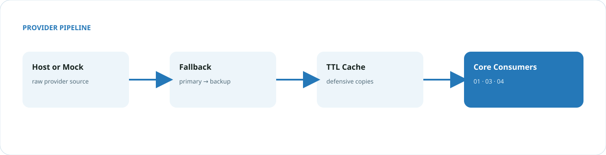

# 🔌 Data Fetcher & Provider Layer

<p align="center">
  
</p>

<p align="right">
  <strong>繁體中文</strong> · <a href="./README.en.md">English</a> ·
  <a href="../README.md">專案首頁</a>
</p>

<p>
  <kbd>DataProvider</kbd>
  <kbd>Mock Data</kbd>
  <kbd>TTL Cache</kbd>
  <kbd>Retry</kbd>
  <kbd>Fallback</kbd>
  <kbd>Apache-2.0</kbd>
</p>

## 🧭 目錄

- [為何需要 Provider](#為什麼要有-provider-layer)
- [DataProvider Contract](#dataprovider-contract)
- [Mock 與 Provider Stack](#mockedataprovider)
- [Cache 與 Retry](#cache)
- [Fallback](#fallback)
- [Quick Start](#quick-start)
- [Custom DataProvider](#custom-dataprovider)
- [Integration Patterns](#integration-patterns)
- [Troubleshooting](#troubleshooting)
- [FAQ](#faq)
- [Roadmap](#roadmap)
- [License](#license)

> **所有核心 modules 共用的資料邊界：統一 contracts、mock data、cache、retry、fallback 與 fault tolerance。**

## 🧩 為什麼要有 Provider Layer？

如果 ETA、Search 與 Navigation 各自處理 HTTP、cache、auth 與 vendor payload，它們會變得難以測試、替換及獨立開源。Provider layer 把資料來源隔離在單一介面後面。

| Without Provider Layer | With Provider Layer |
| --- | --- |
| 每個 module 各自呼叫 API | 一個 `DataProvider` contract |
| Tests 依賴 network | 預設 `MockDataProvider` |
| Token／endpoint 容易分散 | Secrets 留在 host application |
| Retry 邏輯重複 | `withRetry` 可重用 |
| Cache 行為不一致 | `TtlCache` + `CachedDataProvider` |
| Primary source 故障即中斷 | `FallbackDataProvider` |

## ✨ 功能

<p align="center">
  
</p>

| 功能 | 實作 |
| --- | --- |
| Shared contracts | Transit、ETA、LRT、WalkingPath、RouteGeometry |
| Mock data | 虛構 routes、stops、live snapshot、schedule |
| Cache | Generic `TtlCache` 與 `CachedDataProvider` |
| Retry | Exponential delay 的 `withRetry` |
| Fault tolerance | Primary → fallback provider |
| Defensive output | Mock／cache 回傳 `structuredClone` |

## 📊 At a Glance

| Metric | Value |
| --- | ---: |
| Provider methods | 10 |
| Mock JSON files | 8 |
| Unit tests in package | 8 |
| Network calls by default | 0 |
| Dependencies | 0 runtime packages |

## 🚀 Quick Start

```powershell
npm run build -w @onedirect/data-fetcher-provider-layer
npm run test -w @onedirect/data-fetcher-provider-layer
```

## 📦 DataProvider Contract

| Method | Return |
| --- | --- |
| `getRoutes()` | `TransitRoute[]` |
| `getRoute(routeId)` | `TransitRoute \| null` |
| `getStops()` | `TransitStop[]` |
| `getLrtLines()` | `LrtLine[]` |
| `getLrtStations()` | `TransitStop[]` |
| `getRouteGeometries()` | `RouteGeometryMap` |
| `getLiveRoute(routeId, direction?)` | `LiveRouteSnapshot \| null` |
| `getLrtScheduleProfile(lineId)` | `LrtScheduleProfile \| null` |
| `getWalkingPath(from, to)` | `WalkingPath \| null` |
| `reload()` | `void` |

所有 consumer 只應依賴這個 interface，而不是 `fetch()`、database SDK 或 vendor response type。

## 🧪 MockDataProvider

```ts
import { MockDataProvider } from "@onedirect/data-fetcher-provider-layer";

const provider = new MockDataProvider(150);
const routes = await provider.getRoutes();
```

Constructor 接受 optional `latencyMs`：

- `0`：直接回傳。
- `> 0`：模擬 loading state。

回傳會先 `structuredClone`，consumer mutation 不會污染 mock source。

## 🧱 完整 Provider Stack

```ts
import {
  CachedDataProvider,
  FallbackDataProvider,
  MockDataProvider,
} from "@onedirect/data-fetcher-provider-layer";

const primary = new MockDataProvider();
const fallback = new MockDataProvider(5);

const provider = new CachedDataProvider(
  new FallbackDataProvider(primary, fallback),
  30_000,
);

const [routes, stops, geometry] = await Promise.all([
  provider.getRoutes(),
  provider.getStops(),
  provider.getRouteGeometries(),
]);
```

## 🗃️ Cache

```ts
import { TtlCache } from "@onedirect/data-fetcher-provider-layer";

let now = Date.now();
const cache = new TtlCache<string, number>(
  30_000,
  100,
  () => now,
);
```

`TtlCache` 支援：

- `ttlMs` 驗證。
- max entries with FIFO eviction。
- injectable clock，方便 deterministic test。
- `get(key, { allowStale })`。

`CachedDataProvider` 會 cache route、stops、LRT、geometry、live data、schedule 與 walking path；`reload()` 會先清 cache。

## 🔁 Retry

```ts
import { withRetry } from "@onedirect/data-fetcher-provider-layer";

const data = await withRetry(
  () => loadSomething(),
  {
    maxAttempts: 3,
    baseDelayMs: 100,
    maxDelayMs: 2_000,
  },
);
```

測試可注入 sleeper，避免真正等待。

## 🛡️ Fallback

`FallbackDataProvider(primary, fallback)` 會在每個 method 獨立 fallback。`activeSources()` 會記錄哪一個 provider／method 實際成功，方便 host 觀察。

## 🧪 Mock Fixtures

| File | 用途 |
| --- | --- |
| `routes.json` | Bus route 及 direction |
| `stops.json` | Bus stops |
| `lrt-lines.json` | LRT geometry、station order |
| `lrt-stations.json` | LRT stops |
| `live-route.json` | Vehicle observations |
| `lrt-schedule-profiles.json` | Headway windows |
| `route-geometries.json` | Bus route line strings |
| `walking-path.json` | Fictional walking geometry |

## 🔌 Custom DataProvider

```ts
import type { DataProvider } from "@onedirect/data-fetcher-provider-layer";

export class BackendProvider implements DataProvider {
  readonly id = "backend";

  constructor(private readonly client: BackendClient) {}

  getRoutes() {
    return this.client.routes();
  }

  getRoute(routeId: string) {
    return this.client.route(routeId);
  }

  // 實作其餘 method，並把 vendor payload 轉成 shared contracts。
}
```

Host provider 負責：

- Authentication。
- Timeout／AbortSignal。
- Backend-specific retry。
- Error mapping。
- Cache invalidation。
- Secrets management。

## 🧱 錯誤與邊界

- 不要在 provider 外 leak vendor response。
- 不要把 transient error 當成 empty data。
- Cache 不應回傳 mutable reference。
- Fallback 失敗時應保留原始 error context。
- Retry 不應無限重試。

## ✅ 測試

```powershell
npm run test -w @onedirect/data-fetcher-provider-layer
```

覆蓋 defensive copies、geometry、TTL expiry、retry delay、fallback、cache reload。

## 🔒 安全邊界

- Fixture 必須虛構。
- 不可加入真實 endpoint、Token、Cookie、Headers、簽名或 production payload。
- Provider log 不應包含 credential 或完整 upstream body。

## 🤖 AI 協作

修改 contracts 或 wrappers 前先閱讀 [AGENTS.md](./AGENTS.md)。

## ✅ 適合使用場景

- 多個 frontend／backend modules 需要共用同一套 transit contracts。
- 你希望在沒有 production credentials 時仍可完整開發。
- 你需要一致 cache、retry 與 fallback 行為。
- 你想把 vendor SDK 隔離在 host application。
- 你要把 shared types 發佈成獨立 npm package。

## 🚫 不適合使用場景

- 直接包含 operator-specific web scraping。
- 在 frontend bundle 內保存 service-role credentials。
- 把 raw upstream response 當成 public contract。
- 無限制 retry 或永久 cache。

## 🧭 Contract Design Rules

1. IDs 一律以 string 對外。
2. Coordinates 使用 `{ lat, lng }`。
3. 所有 arrays 保持 deterministic order。
4. Optional 不代表 unknown；不使用 vendor-specific passthrough。
5. Provider 不應回傳 mutable internal reference。
6. Error 應保持可觀察，不可靜默變成空資料。
7. Cache key 必須包含所有影響結果的參數。

## 🔌 Provider Method Reference

### Routes

`getRoutes()` 回傳巴士 route catalog；`getRoute(routeId)` 回傳單一路線，找不到時為 `null`。

### Stops

`getStops()` 回傳 bus stops；`getLrtStations()` 回傳 LRT stops。兩者都使用 `TransitStop`。

### LRT

`getLrtLines()` 提供 station order 及 line geometry；`getLrtScheduleProfile()` 提供 headway windows。

### Geometry

`getRouteGeometries()` 回傳 route direction 的 geographic line；`getWalkingPath()` 回傳步行 geometry。

### Live

`getLiveRoute(routeId, direction)` 回傳 observed stop sequence、vehicle position 與速度。

### Reload

`reload()` 用作 invalidate cache 及重新載入 catalog。

## 🧩 Integration Patterns

### REST Adapter

Host provider 以 `fetch` 或 SDK 取得資料，於內部完成 authentication，之後 map 成 shared contracts。

### Database Adapter

SQL query result 應先正規化，再傳出 typed arrays；不要將 database row 直接當成 public type。

### Composite Provider

可以組合：

```ts
const provider = new CachedDataProvider(
  new FallbackDataProvider(primary, backup),
  30_000,
);
```

### Test Provider

Tests 可使用 `MockDataProvider(latency)` 模擬 slow response；failure／fallback 則以 local subclass 注入 error。

## 🗃️ Cache Semantics

- Cache expiry 以 milliseconds 為單位。
- 回傳 cloned output。
- `reload()` 清空整個 cache。
- Key 必須包含 route、stop、direction 或 coordinate。
- Stale read 需要 caller 明確要求。

## 🔁 Retry Semantics

- Retry 只應包裝 transient operation。
- `maxAttempts` 包含第一次 attempt。
- Delay 使用 exponential backoff。
- 測試注入 sleeper。
- Permanent validation errors 不應重試。

## 🧯 Troubleshooting

### Cache 一直是舊資料

確認 TTL；需要即時刷新時呼叫 `reload()` 或使用 shorter TTL。

### Fallback 沒有生效

檢查 primary 是否真的 throw；若它回傳空 array，fallback wrapper 不會判斷為 failure。

### 回傳資料被外部修改

Mock 與 cache 已 clone；自訂 provider 亦應遵守 defensive copy rule。

### Tests 很慢

不要使用 production latency；`latencyMs` 只用於少數 loading-state tests。

## ❓ FAQ

### Provider 可以 cache 幾久？

依 backend 更新頻率；Demo 預設 30 秒。

### 可否直接回傳 vendor response？

不可以。必須先 map 成 shared contracts。

### Fallback 應否 silent？

不應完全 silent；`activeSources()` 及 host logs 應可觀察。

### MockDataProvider 是否 production ready？

它是 deterministic test／demo provider，不是 production backend。

## 🗺️ Roadmap

- [ ] Add async single-flight provider wrapper.
- [ ] Add structured provider error classes.
- [ ] Add optional response schema validation.
- [ ] Add pagination contracts for large catalogs.

## 📄 License

Apache-2.0，詳見 [LICENSE](../LICENSE)。

---

<p align="center"><a href="#">Back to top</a></p>
