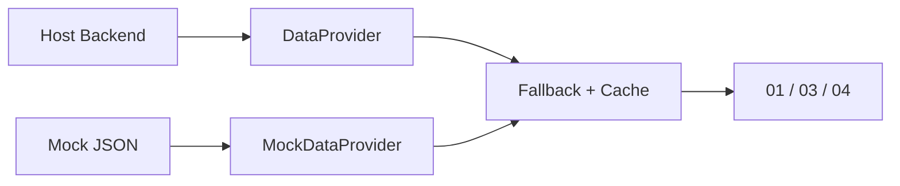

# 02 · Data Fetcher & Provider Layer

<p align="center">
  
</p>

<p>
  <kbd>DataProvider</kbd>
  <kbd>TTL Cache</kbd>
  <kbd>Retry</kbd>
  <kbd>Fallback</kbd>
  <kbd>Mock Data</kbd>
</p>

> **所有核心 module 共用的資料邊界：統一 contracts、cache、retry、fallback 與完全離線的 MockDataProvider。**

## 功能

<p align="center">
  
</p>

| 能力 | Export |
| --- | --- |
| Shared contracts | TransitRoute、TransitStop、LiveRouteSnapshot、ETA、LRT、Journey 所需 primitives |
| Data access | `DataProvider` |
| Offline implementation | `MockDataProvider` |
| TTL cache | `TtlCache`、`CachedDataProvider` |
| Retry | `withRetry` |
| Fault tolerance | `FallbackDataProvider` |



## 快速開始

```powershell
npm run build -w @onedirect/data-fetcher-provider-layer
npm run test -w @onedirect/data-fetcher-provider-layer
```

## 使用範例

```ts
import {
  CachedDataProvider,
  FallbackDataProvider,
  MockDataProvider,
} from "@onedirect/data-fetcher-provider-layer";

const mock = new MockDataProvider();
const fallback = new MockDataProvider(5);
const provider = new CachedDataProvider(
  new FallbackDataProvider(fallback, mock),
  30_000,
);

const [routes, stops, geometries] = await Promise.all([
  provider.getRoutes(),
  provider.getStops(),
  provider.getRouteGeometries(),
]);
```

## `DataProvider` methods

| Method | Return |
| --- | --- |
| `getRoutes()` | `TransitRoute[]` |
| `getRoute(id)` | `TransitRoute \| null` |
| `getStops()` | `TransitStop[]` |
| `getLrtLines()` | `LrtLine[]` |
| `getLrtStations()` | `TransitStop[]` |
| `getRouteGeometries()` | `RouteGeometryMap` |
| `getLiveRoute(routeId, direction?)` | `LiveRouteSnapshot \| null` |
| `getLrtScheduleProfile(lineId)` | `LrtScheduleProfile \| null` |
| `getWalkingPath(from, to)` | `WalkingPath \| null` |
| `reload()` | `void` |

## Custom `DataProvider`

```ts
import type { DataProvider } from "@onedirect/data-fetcher-provider-layer";

export class HostProvider implements DataProvider {
  readonly id = "host-backend";

  constructor(private readonly backend: HostBackend) {}

  getRoutes() {
    return this.backend.routes();
  }

  // 其餘方法將 host response 映射成 shared contracts。
}
```

> Cache、retry 與 fallback 可包裝任何 `DataProvider`。真實 endpoint、credentials 與 SDK 只留在宿主應用。

## AI 協作

閱讀 [`AGENTS.md`](./AGENTS.md)，保持 contracts 平台中立及 fixtures 完全虛構。
