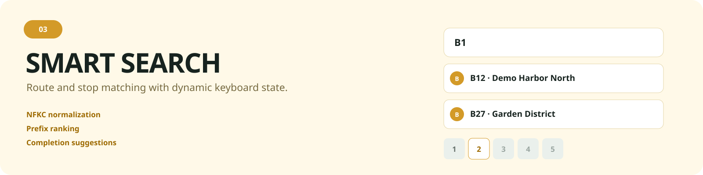
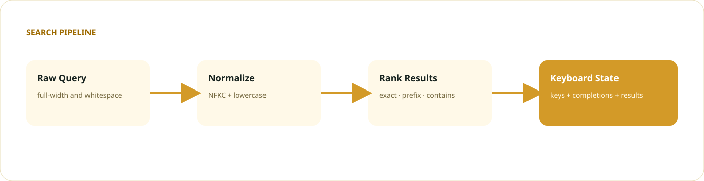

# ⌨️ Smart Transit Search Keyboard

<p align="center">
  
</p>

<p align="right">
  <a href="./README.md">繁體中文</a> · <strong>English</strong> ·
  <a href="../README.en.md">Project Home</a>
</p>

<p>
  <kbd>Route Search</kbd>
  <kbd>Stop Search</kbd>
  <kbd>Prefix Ranking</kbd>
  <kbd>Dynamic Keypad</kbd>
  <kbd>Apache-2.0</kbd>
</p>

## 🧭 Contents

- [Problem](#what-problem-does-it-solve)
- [Features](#features)
- [Quick Start](#quick-start)
- [Main API](#main-api)
- [Ranking](#ranking)
- [Dynamic Keyboard](#dynamic-keyboard)
- [Complete Example](#complete-example)
- [Custom DataProvider](#custom-dataprovider)
- [Accessibility](#accessibility)
- [Troubleshooting](#troubleshooting)
- [FAQ](#faq)
- [Roadmap](#roadmap)
- [License](#license)

> **Search routes, stops, station codes, or full-width input while enabling only keys that can continue a valid result.**

## What Problem Does It Solve?

Transit search UI often mixes normalization, ranking, completion, and keypad state into component code. This package keeps search behavior framework-agnostic.

| Problem | Response |
| --- | --- |
| Full-width `ＡＰ１` | NFKC normalization |
| `B1` should rank `B12` first | Exact and prefix scoring |
| Stop names contain route IDs | Search aliases |
| Invalid keys remain clickable | Dynamic key availability |
| Input and suggestions drift apart | Controller-owned state |
| UI calls APIs directly | Provider-backed search index |

## ✨ Features

<p align="center">
  
</p>

| Feature | Description |
| --- | --- |
| Query normalization | NFKC, lowercase, whitespace and slash handling |
| Unified index | Bus routes, bus stops, LRT lines, LRT stations |
| Ranking | Exact ID, prefix ID, contains ID, then name |
| Completions | Complete selectable prefixes |
| Dynamic keys | Enable only valid continuation keys |
| Controller | Set, append, backspace, select, state |

## 📊 At a Glance

| Metric | Value |
| --- | ---: |
| Candidate kinds | 4 |
| Unit tests in package | 5 |
| Runtime UI dependency | 0 |
| Default source | `DataProvider` |

## 🚀 Quick Start

```powershell
npm run build -w @onedirect/smart-transit-search-keyboard
npm run test -w @onedirect/smart-transit-search-keyboard
```

## 🔌 Main API

### `normalizeSearchQuery(value)`

Normalizes full-width characters, letter case, whitespace, and slash variants.

### `createSearchIndex(provider)`

Loads routes, stops, LRT lines, and stations into a unified candidate index.

### `searchTransit(provider, query, options?)`

```ts
const results = await searchTransit(provider, "B1", {
  limit: 10,
  kinds: ["route", "stop"],
});
```

### `SmartTransitSearchController`

Owns query state, append, backspace, suggestion selection, completions, and keyboard state.

## 🏆 Ranking

| Match | Score |
| --- | ---: |
| Exact route ID | `1000` |
| Exact name | `900` |
| Route prefix | `820` |
| Route ID contains query | `560` |
| Name contains query | `420` |

Ties use numeric-aware route ID sorting for deterministic output.

## ⌨️ Dynamic Keyboard

For query `B1`, the package disables keys that cannot continue a valid route prefix and enables keys such as `2` when `B12` exists.

## ✨ Completion

Completion suggestions return full route prefixes so a UI can render suggestion chips without duplicating search rules.

## 🧵 Complete Example

```ts
import { MockDataProvider } from "@onedirect/data-fetcher-provider-layer";
import {
  SmartTransitSearchController,
  createSearchIndex,
  searchTransit,
} from "@onedirect/smart-transit-search-keyboard";

const provider = new MockDataProvider();
const index = await createSearchIndex(provider);
const controller = new SmartTransitSearchController(index);

console.log(await searchTransit(provider, "Harbor"));
console.log(controller.append("B").suggestions);
```

## 🔌 Custom DataProvider

Override route and stop loading in a host provider. Do not add remote autocomplete endpoints or credentials to the search package.

## ✅ Tests

Coverage includes full-width input, exact ranking, route and stop search, disabled keys, completion, append, and backspace.

## 🔒 Security

- No remote autocomplete endpoint.
- Do not log query history together with location or identity.
- Build indexes only from an injected provider.

## 🤖 AI Collaboration

Read [AGENTS.md](./AGENTS.md) before changing ranking or keyboard behavior.

## ✅ When to Use It

- Route IDs contain letter prefixes or suffixes.
- Users may type full-width characters or mixed case.
- You need a custom keypad instead of the native keyboard.
- Search should cover routes and stops together.
- Ranking and completion must be deterministic.

## 🚫 When Not to Use It

- You need a server-side full-text search engine.
- You need address geocoding.
- You need to persist user search history.
- You want to call a third-party autocomplete API from the package.

## 🧩 Candidate Model

Each candidate has an ID, kind, title, subtitle, aliases, and route IDs. Aliases cover route codes, station codes, route membership, and description variants.

## 🏆 Ranking Examples

| Query | Expected top result |
| --- | --- |
| `AP1` | Exact AP1 route |
| `AP` | AP-prefix routes |
| `B1` | B12 before description-only matches |
| `Harbor` | Harbor North stop |
| `l1` | LRT station code L101 |

## ⌨️ Keyboard Design

The virtual keypad enables only keys that can continue a valid candidate prefix. Invalid keys are disabled rather than silently ignored.

## 🔁 Controller Lifecycle

Create an index, instantiate the controller, update the query from input, append keypad values, handle backspace, select a result, and render the returned state.

## 🧩 UI Integration

The controller is framework-agnostic. React, Vue, Svelte, and vanilla UI code can render the same state without adding a framework dependency to the core.

## ♿ Accessibility

- Label the search input.
- Use real disabled buttons.
- Make suggestions keyboard-accessible.
- Announce result counts with live regions when appropriate.
- Never use color alone to communicate state.

## 🧯 Troubleshooting

### Full-width input returns nothing

Run the input through `normalizeSearchQuery`.

### Every key is disabled

Check that the candidate index loaded and the current prefix exists.

### Route and stop ordering is unexpected

Review aliases and ranking scores instead of reordering in the UI.

### Selecting a result does not update input

The controller returns the selected result; the UI must write the selected state back to its input.

## ❓ FAQ

### Why search stop codes?

Station codes are compact, stable, and common in transit interfaces.

### Can it search LRT lines?

Yes. Candidate kind includes `lrt-line`.

### Does it support typo correction?

No. Current behavior is normalized exact, prefix, and contains matching.

### Does it persist queries?

No.

## 🗺️ Roadmap

- Optional fuzzy matching.
- Pinyin and Portuguese aliases.
- Configurable scoring weights.
- Grouped result categories.

## 📄 License

Apache-2.0. See [LICENSE](../LICENSE).

---

<p align="center"><a href="#">Back to top</a></p>
