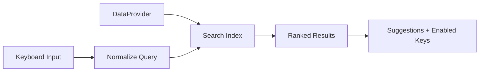

# 03 · Smart Transit Search Keyboard

<p align="center">
  
</p>

<p>
  <kbd>Route Search</kbd>
  <kbd>Stop Search</kbd>
  <kbd>Prefix Ranking</kbd>
  <kbd>Dynamic Keypad</kbd>
</p>

> **輸入 `B1`、`ＡＰ１`、`Harbor` 或站點代碼，即時找出路線／站點，並只啟用能繼續組成有效結果的按鍵。**

## 功能

<p align="center">
  
</p>

- 全形英數字、大小寫、空白及斜線正規化。
- Exact ID、prefix、contains and name ranking。
- Route、bus stop、LRT line／station 共用 index。
- Dynamic key availability。
- Completion 與 framework-agnostic keyboard controller。



## 快速開始

```powershell
npm run build -w @onedirect/smart-transit-search-keyboard
npm run test -w @onedirect/smart-transit-search-keyboard
```

## 核心 API

| Export | 用途 |
| --- | --- |
| `normalizeSearchQuery` | NFKC、大小寫與空白正規化 |
| `buildSearchCandidates` | 由 routes／stops／LRT network 建立 search index |
| `createSearchIndex` | 從 `DataProvider` 非同步載入 index |
| `searchTransit` | Provider-backed search shortcut |
| `searchCandidates` | 搜尋與排序候選資料 |
| `SmartTransitSearchController` | Query、append、backspace、select 與 keyboard state |
| `buildKeyAvailability` | 動態啟用／停用按鍵 |
| `completionSuggestions` | 回傳可完成的有效 prefix |

## 使用範例

```ts
import { MockDataProvider } from "@onedirect/data-fetcher-provider-layer";
import {
  SmartTransitSearchController,
  createSearchIndex,
  searchTransit,
} from "@onedirect/smart-transit-search-keyboard";

const provider = new MockDataProvider();
const results = await searchTransit(provider, "B1");
const candidates = await createSearchIndex(provider);
const keyboard = new SmartTransitSearchController(candidates);

console.log(results);
console.log(keyboard.append("B").suggestions);
```

## Custom `DataProvider`

```ts
import { MockDataProvider } from "@onedirect/data-fetcher-provider-layer";
import { searchTransit } from "@onedirect/smart-transit-search-keyboard";

class HostSearchProvider extends MockDataProvider {
  readonly id = "host-search";

  override getRoutes() {
    return this.backendRoutesPromise();
  }

  override getStops() {
    return this.backendStopsPromise();
  }
}

export function search(provider: HostSearchProvider, query: string) {
  return searchTransit(provider, query);
}
```

> Search core 不直接連 network。真實 backend、auth 與 caching 必須在 provider layer／宿主應用處理。

## AI 協作

修改 ranking、normalization 或 keyboard state 前，閱讀 [`AGENTS.md`](./AGENTS.md)。
