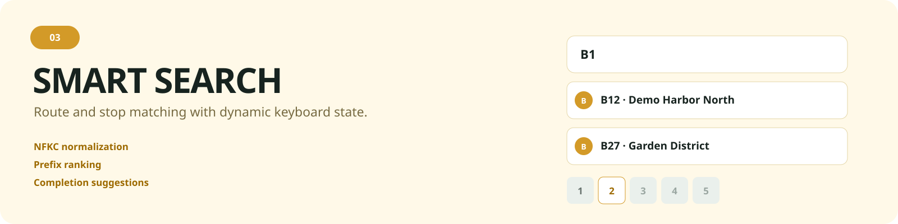
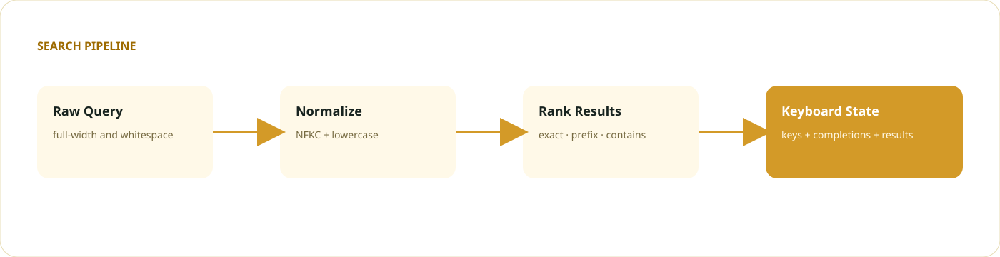

# ⌨️ Smart Transit Search Keyboard

<p align="center">
  
</p>

<p align="right">
  <strong>繁體中文</strong> · <a href="./README.en.md">English</a> ·
  <a href="../README.md">專案首頁</a>
</p>

<p>
  <kbd>Route Search</kbd>
  <kbd>Stop Search</kbd>
  <kbd>Prefix Ranking</kbd>
  <kbd>Dynamic Keypad</kbd>
  <kbd>Apache-2.0</kbd>
</p>

## 🧭 目錄

- [問題背景](#這個模組解決什麼問題)
- [功能](#功能)
- [Quick Start](#quick-start)
- [主要 API](#主要-api)
- [Ranking](#ranking)
- [Dynamic Keyboard](#dynamic-keyboard)
- [完整範例](#完整使用範例)
- [Custom DataProvider](#custom-dataprovider)
- [Accessibility](#accessibility)
- [Troubleshooting](#troubleshooting)
- [FAQ](#faq)
- [Roadmap](#roadmap)
- [License](#license)

> **輸入路線、站點、站碼或全形字符，即時搜尋並只啟用能繼續形成有效結果的按鍵。**

## 🧩 這個模組解決什麼問題？

交通搜尋 UI 通常同時處理 normalization、ranking、completion 與 keyboard disabled state，導致同一套規則散落在 components。此 package 把搜尋核心與 UI 分開。

| 問題 | 處理方式 |
| --- | --- |
| 全形 `ＡＰ１` | NFKC normalization |
| `B1` 應先出 `B12` | Exact／prefix ranking |
| Stop 名稱含 route ID | Candidate aliases |
| 無效按鍵仍可點 | Dynamic availability |
| Input 與 suggestions 不同步 | Controller state |
| UI 直接查 API | `DataProvider` search index |

## ✨ 功能

<p align="center">
  
</p>

| 功能 | 說明 |
| --- | --- |
| Query normalization | NFKC、lowercase、space／slash normalization |
| Unified index | Bus route、bus stop、LRT line、LRT station |
| Ranking | Exact ID → prefix ID → contains ID → name |
| Completions | 回傳完整可選 prefix |
| Dynamic keys | 只 enable 能延續有效 route prefix 的字元 |
| Controller | `setQuery`、`append`、`backspace`、`select` |

## 📊 At a Glance

| Metric | Value |
| --- | ---: |
| Candidate kinds | 4 |
| Unit tests in package | 5 |
| Runtime UI dependency | 0 |
| Default data source | `DataProvider` |

## 🚀 Quick Start

```powershell
npm run build -w @onedirect/smart-transit-search-keyboard
npm run test -w @onedirect/smart-transit-search-keyboard
```

## 🔌 主要 API

### `normalizeSearchQuery(value)`

```ts
normalizeSearchQuery("  ＡＰ １ ");
// "ap1"
```

### `createSearchIndex(provider)`

由 Provider 載入 routes、stops、LRT lines 與 stations，建立統一 candidates。

### `searchTransit(provider, query, options?)`

```ts
const results = await searchTransit(provider, "B1", {
  limit: 10,
  kinds: ["route", "stop"],
});
```

### `SearchResult`

```ts
type SearchResult = {
  candidate: SearchCandidate;
  score: number;
  matchType:
    | "exact-id"
    | "prefix-id"
    | "contains-id"
    | "exact-name"
    | "contains-name";
};
```

### `SmartTransitSearchController`

```ts
const controller = new SmartTransitSearchController(candidates);

controller.setQuery("B");
controller.append("1");
controller.backspace();
controller.select("B12");
controller.getState();
```

## 🏆 Ranking

| Match | Score |
| --- | ---: |
| Exact route ID | `1000` |
| Exact name | `900` |
| Route prefix | `820` |
| Route ID contains query | `560` |
| Name contains query | `420` |

Tie-breaker 使用 numeric-aware route ID sorting，確保結果穩定。

## ⌨️ Dynamic Keyboard

```ts
const keys = buildKeyAvailability("B1", candidates, [
  "1", "2", "3",
]);
```

對 `B1`：

- `1` disabled，因 `B11` 不存在。
- `2` enabled，因 `B12` 存在。
- `3` disabled。

## ✨ Completion

`completionSuggestions("B", candidates)` 會回傳例如 `b12`、`b27` 的完整 prefix，讓 UI 可以直接顯示 suggestion chip。

## 🧵 完整使用範例

```ts
import { MockDataProvider } from "@onedirect/data-fetcher-provider-layer";
import {
  SmartTransitSearchController,
  createSearchIndex,
  searchTransit,
} from "@onedirect/smart-transit-search-keyboard";

const provider = new MockDataProvider();
const index = await createSearchIndex(provider);
const controller = new SmartTransitSearchController(index);

console.log(await searchTransit(provider, "Harbor"));
console.log(controller.append("B").suggestions);
```

## 🔌 Custom DataProvider

```ts
import { MockDataProvider } from "@onedirect/data-fetcher-provider-layer";

class HostSearchProvider extends MockDataProvider {
  readonly id = "host-search";

  override getRoutes() {
    return this.hostClient.routes();
  }

  override getStops() {
    return this.hostClient.stops();
  }
}
```

Search Module 不保存 endpoint、credential、cache 或 vendor response。

## ✅ 測試

- Full-width normalization。
- Exact route ranking。
- Route／stop provider search。
- Disabled keys。
- Append、completion、backspace。

## 🔒 安全邊界

- 不加入 remote autocomplete endpoint。
- 不記錄 query 與 location／user identity。
- Search index 必須由 injected provider 建立。

## 🤖 AI 協作

修改 ranking 或 keyboard state 前先閱讀 [AGENTS.md](./AGENTS.md)。

## ✅ 適合使用場景

- 路線號碼有字母前綴或 suffix，例如 `AP1`、`25AX`。
- 使用者會輸入全形字符或不同大小寫。
- 你需要在沒有 keyboard 彈出的情況下提供 virtual keypad。
- 你想同時搜尋 route 及 stop。
- 你需要 stable ranking 及 completion。

## 🚫 不適合使用場景

- 需要 server-side full-text search engine。
- 需要地址 geocoding。
- 需要保存使用者搜尋歷史。
- 需要直接呼叫第三方 autocomplete API。

## 🧩 Search Candidate Model

```ts
type SearchCandidate = {
  id: string;
  kind: "route" | "stop" | "lrt-line" | "lrt-station";
  title: string;
  subtitle: string;
  aliases: string[];
  routeIds: string[];
};
```

`aliases` 用於 route code、station code、route membership 及 description variants。

## 🏆 Ranking Examples

| Query | Expected top |
| --- | --- |
| `AP1` | exact route AP1 |
| `AP` | AP-prefix routes |
| `B1` | B12 ahead of description-only matches |
| `Harbor` | stop named Harbor North |
| `l1` | LRT station code L101 |

## ⌨️ Keyboard Design

Virtual keypad 不是單純顯示所有字母，而是根據 candidate prefixes 動態 enable／disable。

```text
query = B
valid next digits = 1, 2

query = B1
valid next digits = 2
```

此設計可減少無效輸入，但使用者仍可 backspace。

## 🔁 Controller Lifecycle

1. `createSearchIndex(provider)`
2. `new SmartTransitSearchController(index)`
3. `setQuery()` from input event
4. `append()` from keypad
5. `backspace()` from delete key
6. `select()` from suggestion result
7. `getState()` to render suggestions and keys

## 🧩 UI Integration

React、Vue、Svelte 或 vanilla UI 都可以使用 controller。Package 不包含 React component，避免 UI framework 成為 core dependency。

## ♿ Accessibility

- Input 應有 label。
- Disabled key 要使用真正 `disabled` attribute。
- Suggestion 應為 keyboard-accessible button。
- Live result count 可用 `aria-live`。
- 不要只靠顏色表示 enabled／disabled。

## 🧯 Troubleshooting

### 搜尋 `ＡＰ１` 沒有結果

確認 query 經 `normalizeSearchQuery`；測試使用 NFKC。

### Keypad 全部 disabled

檢查 candidate index 是否成功載入，以及 prefix 是否真的存在。

### Route 與 stop 排序不合理

檢查 alias 及 score；不要用 UI 再私自重排。

### 選取後 input 沒有更新

`select()` 會回傳 selected result；UI 仍需將 controller state 寫回 input。

## ❓ FAQ

### 為何 stop ID 使用 code？

Display 及搜尋通常以 station code 操作；`id` 可保留在 subtitle 或 host mapping。

### 是否可以搜尋 LRT line？

可以，candidate kind 為 `lrt-line`。

### Ranking 是否支援 fuzzy typo？

目前是 normalized exact／prefix／contains，不包含 edit distance。

### 是否會保存 query？

Package 不提供 persistence。

## 🗺️ Roadmap

- [ ] Optional fuzzy matching.
- [ ] Pinyin／Portuguese aliases.
- [ ] Ranking weights configuration.
- [ ] Result category grouping.

## 📄 License

Apache-2.0，詳見 [LICENSE](../LICENSE)。

---

<p align="center"><a href="#">Back to top</a></p>
