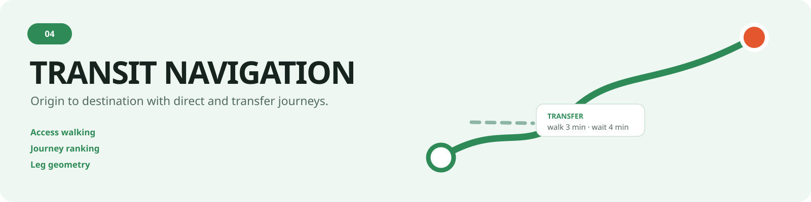
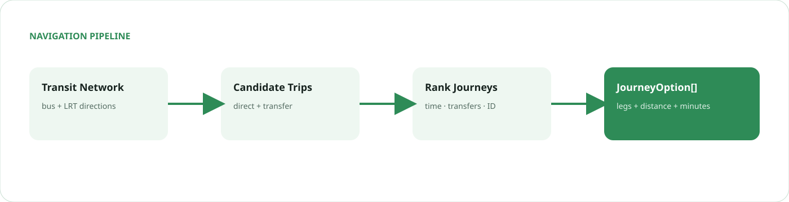

# 🧭 Transit Navigation

<p align="center">
  
</p>

<p align="right">
  <a href="./README.md">繁體中文</a> · <strong>English</strong> ·
  <a href="../README.en.md">Project Home</a>
</p>

<p>
  <kbd>Origin → Destination</kbd>
  <kbd>Direct Route</kbd>
  <kbd>Transfer</kbd>
  <kbd>Journey Legs</kbd>
  <kbd>Apache-2.0</kbd>
</p>

## 🧭 Contents

- [Problem](#what-problem-does-it-solve)
- [Features](#features)
- [Quick Start](#quick-start)
- [Main API](#main-api)
- [Journey Output](#journey-output)
- [Routing Rules](#routing-rules)
- [Mathematical Model](#-mathematical-model)
- [Complete Example](#complete-example)
- [Custom DataProvider](#custom-dataprovider)
- [Troubleshooting](#troubleshooting)
- [FAQ](#faq)
- [Roadmap](#roadmap)
- [License](#license)

> **Turn origin and destination coordinates into ranked bus and LRT journeys with walking, riding, and transfer legs.**

## What Problem Does It Solve?

Navigation is more than drawing a line. The engine handles access walking, boarding and alighting stops, transfer distance, direction, waiting time, and journey ranking.

| Input | Processing | Output |
| --- | --- | --- |
| Origin and destination | Nearby access stops | Boarding and alighting candidates |
| Bus and LRT routes | Network construction | Transit services |
| Transfer distance | Threshold check | Transfer candidates |
| Journey metrics | Time and transfer ranking | `JourneyOption[]` |
| Walking path | Provider geometry or fallback | `JourneyLeg.coordinates` |

## ✨ Features

<p align="center">
  
</p>

| Capability | Description |
| --- | --- |
| Network builder | Convert route directions into services |
| Direct route | Board and alight on the same service |
| Transfer route | Two services plus walking transfer |
| Traffic-aware ETA | BPR congestion, signal delay, and turn penalty |
| Ranking | Weighted total time, walking, transfers, and ETA variance |
| Leg generation | Walk, bus, and LRT legs |
| Geometry | Walking paths and transit stop geometry |
| Explainable output | Walk, wait, ride, score, congestion, and transfer buffer |

## 📊 At a Glance

| Metric | Value |
| --- | ---: |
| Transit modes | Bus + LRT |
| Supported transfers | 1 |
| Unit tests in package | 18 |
| External routing service | 0 |

## 🚀 Quick Start

```powershell
npm run build -w @onedirect/transit-navigation
npm run test -w @onedirect/transit-navigation
```

## 🔌 Main API

### `buildTransitNetwork(input)`

Builds directional services from routes, LRT lines, stations, and route geometry.

### `loadTransitNetwork(provider)`

Loads the same network from a `DataProvider`.

### `calculateJourneyOptions(provider, origin, destination, options?)`

Returns ranked direct and transfer journeys.

### `prepareJourneyGeometry(provider, journey)`

Adds walking geometry through the provider and falls back to a straight line.

### `findBestJourney(journeys)`

Returns the first ranked journey or `null`.

### Mathematical utilities

Every formula is a pure function and can be imported on its own:

```ts
import {
  haversineMeters,
  urbanDistanceMeters,
  bprSpeedKmh,
  segmentTravelSeconds,
  ewmaSpeed,
  walkingMinutes,
  lrtRideMinutes,
  feasibleTransferWaitMinutes,
  congestionRatio,
  routeScore,
} from "@onedirect/transit-navigation";
```

The planner accepts optional search controls:

```ts
type JourneySearchOptions = {
  limit?: number;
  referenceTime?: Date;
  congestionRatio?: number;       // 0..1.5
  urbanDetourFactor?: number;    // 1.22..1.38
  walkingSlopeFactor?: number;   // >= 1
  transferSafetyBufferMinutes?: number;
  routeScoreWeights?: Partial<RouteScoreWeights>;
  liveWaitMinutes?: (serviceId: string, stopId: string) => number | null;
};
```

## 📦 Journey Output

Every journey contains total, waiting, walking, and riding minutes, transfer count, transfer buffer, congestion, ETA variance, score, badges, and a sequence of legs.

Every leg contains:

- `type`: `walk`, `bus`, or `lrt`
- `label`
- `minutes`
- `distanceMeters`
- `from` and `to`
- optional `coordinates`
- optional `waitMinutes`
- optional `waitConfidence`: `realtime` or `scheduled`
- optional `trafficSaturationRatio`

## 🧭 Routing Rules

1. Origin access walk: up to `1400m`.
2. Destination access walk: up to `1600m`.
3. Transfer walk: up to `350m`.
4. Alighting must occur after boarding.
5. Bus free-flow speed defaults to `18.6km/h`, then uses the BPR congestion model.
6. LRT cruise speed is `35km/h` plus `20s` dwell per stop.
7. Live bus ETA comes from the caller; otherwise wait is headway divided by two.
8. LRT uses weekday or weekend headway windows from `LrtScheduleProfile`.
9. Transfers include a `2min` safety buffer and advance to the next vehicle when needed.

## 📐 Mathematical Model

All formulas live in [`src/routing/navigation-math.ts`](./src/routing/navigation-math.ts). Routing maps network data into these pure, unit-tested functions.

### 1. WGS84 distance

$$d_{\mathrm{hav}} = 2R \arcsin\!\left(\sqrt{\sin^2\!\left(\frac{\Delta\phi}{2}\right) + \cos(\phi_1)\cos(\phi_2)\sin^2\!\left(\frac{\Delta\lambda}{2}\right)}\right)$$

`R = 6,371,000m`. Invalid coordinates return `Infinity` so routing rejects them instead of producing a false journey.

### 2. Macau urban detour and walking time

$$d_{\mathrm{urban}} = \alpha_{\mathrm{urban}} d_{\mathrm{hav}}, \qquad 1.22 \le \alpha_{\mathrm{urban}} \le 1.38$$

$$T_{\mathrm{walk}} = \frac{d_{\mathrm{urban}}\eta_{\mathrm{slope}}}{v_{\mathrm{walk}} \cdot 60}, \qquad v_{\mathrm{walk}} = 1.25\mathrm{m/s}$$

Defaults are `αurban = 1.28` and `ηslope = 1.08`. Callers may override both within validated ranges.

### 3. BPR road congestion

$$v_i(t) = \frac{v_{0,i}}{1 + \alpha \left(\frac{q_i(t)}{C_i}\right)^\beta}$$

$$T_{\mathrm{segment},i} = \frac{L_i}{v_i(t)} + N_{\mathrm{signal},i}\bar{w}_{\mathrm{signal}}(t) + P_{\mathrm{turn},i}$$

$$\bar{w}_{\mathrm{signal}}(t) = 15 + 30 \cdot \min\!\left(1.5, \frac{q_i(t)}{C_i}\right)$$

The defaults are `α = 0.15` and `β = 4`. Bus routing estimates one signal every `450m` and adds a `10s` turn penalty for segments over `800m`.

### 4. EWMA speed smoothing

$$\hat{v}_i(t) = \gamma v_{\mathrm{obs},i}(t) + (1-\gamma)v_{\mathrm{hist},i}(t), \qquad 0.35 \le \gamma \le 0.65$$

The default is `γ = 0.5`, preventing one noisy traffic sample from causing a large ETA jump.

### 5. Bus and LRT waiting

$$W_{\mathrm{scheduled}} = \frac{H(t)}{2}$$

A valid caller-provided bus ETA is used as `realtime`; otherwise the planner uses scheduled headway and marks the wait as `scheduled`.

$$T_{\mathrm{ride,LRT}} = \sum_s \frac{L_s}{v_{\mathrm{LRT}}} + N_{\mathrm{stops}}t_{\mathrm{dwell}}$$

Defaults are `vLRT = 35km/h` and `tdwell = 20s`. LRT headway is selected from the weekday or weekend schedule window.

### 6. Missed-transfer protection

$$R_{\mathrm{transfer}} = T_{\mathrm{walk,transfer}} + \delta_{\mathrm{safety}}$$

If the next departure leaves before `Rtransfer`, the planner advances to the first feasible departure:

$$W_{\mathrm{next}} = ETA_{\mathrm{next}} + \left\lceil\frac{R_{\mathrm{transfer}} - ETA_{\mathrm{next}}}{H}\right\rceil H$$

The default safety buffer is `δsafety = 2min`. `JourneyOption.transferBufferMinutes` exposes the remaining allowance.

### 7. Door-to-door journey time

$$T_{\mathrm{total}} = T_{\mathrm{walk,origin}} + \sum_{k=1}^{M}\left(W_{\mathrm{wait},k} + T_{\mathrm{ride},k} + B_{\mathrm{transfer},k}\right) + T_{\mathrm{walk,destination}}$$

`JourneyOption` exposes `walkMinutes`, `waitMinutes`, `ridingMinutes`, and `transferBufferMinutes` separately. Display minutes are rounded up; ranking uses raw fractional minutes.

### 8. Multi-objective ranking

$$J_{\mathrm{route}} = w_1T_{\mathrm{total}} + w_2T_{\mathrm{walk}} + w_3N_{\mathrm{transfers}} + w_4\sigma_{\mathrm{ETA}}$$

Defaults are `w1 = 1`, `w2 = 0.25`, `w3 = 2`, and `w4 = 0.5`. Lower is better. Ties use total minutes, transfer count, and stable ID.

### Macau congestion profile

| Period | Weekday | Weekend |
| --- | ---: | ---: |
| 07:30–09:30, 17:30–19:30 | 0.95 | 0.78 |
| 10:00–17:00 | 0.55 | 0.55 |
| 19:30–23:00 | 0.38 | 0.38 |
| Other | 0.24 | 0.24 |

## 🧵 Complete Example

```ts
import { MockDataProvider } from "@onedirect/data-fetcher-provider-layer";
import {
  calculateJourneyOptions,
  findBestJourney,
  prepareJourneyGeometry,
} from "@onedirect/transit-navigation";

const provider = new MockDataProvider();
const journeys = await calculateJourneyOptions(
  provider,
  { lat: 22.1513, lng: 113.5489 },
  { lat: 22.1569, lng: 113.5663 },
);

const best = findBestJourney(journeys);
if (best) {
  console.log(await prepareJourneyGeometry(provider, best));
}
```

## 🔌 Custom DataProvider

Override route geometry and walking path loading in the host provider. Keep routing endpoints and credentials outside the public package.

## ✅ Tests

Coverage includes a direct mock bus journey, a synthetic transfer, Haversine, urban detour, BPR, signal delay, EWMA, walking, live wait, LRT headway, missed-transfer protection, multi-objective score, congestion sensitivity, unreachable coordinates, and geometry preparation.

## 🔒 Security

- Do not commit user origin or destination data.
- Do not add real routing endpoints or API credentials.
- Fixtures must remain fictional.
- Do not log precise coordinates or user identity.

## 🤖 AI Collaboration

Read [AGENTS.md](./AGENTS.md) before changing the network or routing logic.

## ✅ When to Use It

- Find bus or LRT journeys from a user position.
- Compare direct and one-transfer alternatives.
- Apply explainable traffic-aware ETA without an external routing service.
- Audit walking, waiting, riding, and transfer-buffer minutes separately.
- Show lightweight legs first and prepare geometry only for the selected trip.
- Move route ranking out of UI components.
- Test routing deterministically against a fictional network.

## 🚫 When Not to Use It

- Street-level turn-by-turn navigation.
- Optimization across multiple transfers.
- Direct calls to a private routing backend.
- Sourcing live vehicle GPS directly; this package accepts caller-provided live bus waits only.

## 🔁 Journey Lifecycle

The planner loads the network, selects the Macau congestion and LRT headway profile, finds access stops, generates direct and transfer candidates, applies missed-transfer protection, calculates walking/waiting/riding time and ETA variance, ranks by weighted score, and prepares geometry only when needed.

## 🧩 Service Model

A service includes mode, optional route or line ID, label, color, direction, ordered stops, and geometry. Bus services may provide a fixed headway; LRT services can carry the provider's weekday and weekend schedule profile.

## 📊 Journey Comparison

| Kind | Boarding | Alighting | Transfer |
| --- | --- | --- | --- |
| Direct | One service | Later stop | None |
| Transfer | First service | Second service | One walking transfer |

## ⏱️ Time Model

Total time is the sum of access walking, first wait, first ride, transfer walk, second wait, second ride, and destination access walking. Each component remains available in the output.

## 🗺️ Geometry Strategy

- Bus uses provider geometry with stop fallback.
- LRT uses line geometry and reverses it for reverse directions.
- Walking uses provider geometry with straight-line fallback.
- Alternatives defer geometry until selected.

## 🏆 Ranking

Journeys rank by:

1. Weighted multi-objective score.
2. Total minutes.
3. Transfer count.
4. Stable journey ID.

The score uses raw fractional minutes and caller-overridable weights. Hosts can still apply fare, accessibility, or personal-preference ranking after receiving typed results.

## 🧱 Errors and Limits

- Unreachable coordinates return an empty list.
- Alighting must follow boarding.
- A transfer walk over `350m` is rejected.
- Missing geometry degrades to local coordinates.
- The current planner supports at most one transfer.

## 🧯 Troubleshooting

### No journeys appear

Check access radius, route directions, and stop order.

### Direct journeys exist but transfers do not

Check the transfer-walk threshold and destination progress on the second service.

### Leg order is wrong

The transfer walk must appear between the first and second transit legs.

### Geometry is a straight line

The provider did not return a usable path. The fallback is intentional.

## ❓ FAQ

### Can I add a second transfer?

Extend the candidate model and ranking tests rather than adding transfer logic to UI code.

### Why prepare only the best geometry?

It reduces computation and payload size for alternatives.

### Can travel time use live traffic?

A host can provide additional speed profiles or decorators while keeping a deterministic baseline.

### Does it provide turn-by-turn directions?

No. It models transit legs and access walking.

## 🗺️ Roadmap

- [ ] Multi-transfer candidates.
- [x] Time-dependent Macau congestion profiles.
- [x] Live bus wait and scheduled LRT headway integration.
- [x] Explainable multi-objective journey ranking.
- [ ] Fare metadata hooks.
- [ ] Accessibility-aware ranking.

## 📄 License

Apache-2.0. See [LICENSE](../LICENSE).

---

<p align="center"><a href="#">Back to top</a></p>
