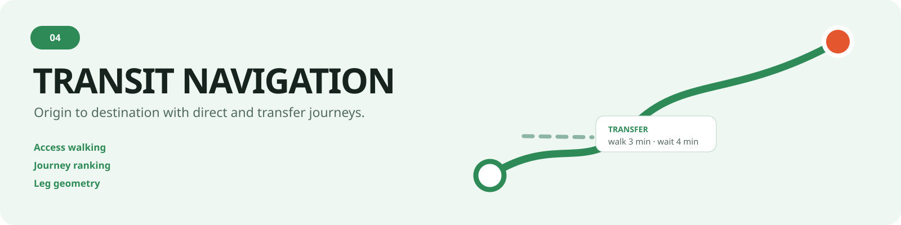
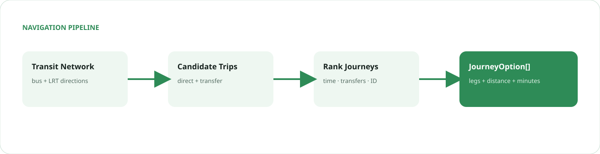

# 🧭 Transit Navigation

<p align="center">
  
</p>

<p align="right">
  <strong>繁體中文</strong> · <a href="./README.en.md">English</a> ·
  <a href="../README.md">專案首頁</a>
</p>

<p>
  <kbd>Origin → Destination</kbd>
  <kbd>Direct Route</kbd>
  <kbd>Transfer</kbd>
  <kbd>Journey Legs</kbd>
  <kbd>Apache-2.0</kbd>
</p>

## 🧭 目錄

- [問題背景](#這個模組解決什麼問題)
- [功能](#功能)
- [Quick Start](#quick-start)
- [主要 API](#主要-api)
- [Journey Types](#journey-types)
- [Routing Rules](#routing-rules)
- [完整範例](#完整使用範例)
- [Custom DataProvider](#custom-dataprovider)
- [Troubleshooting](#troubleshooting)
- [FAQ](#faq)
- [Roadmap](#roadmap)
- [License](#license)

> **把起點、目的地及 Bus／LRT network 轉成 ranked journey options，並輸出步行、乘車與轉乘 legs。**

## 🧩 這個模組解決什麼問題？

Navigation 不只是畫一條線。模組需要處理 access walking、boarding／alighting stop、transfer distance、route direction、等待時間與 journey ranking。

| Input | Processing | Output |
| --- | --- | --- |
| Origin／destination coordinates | Nearby access stops | Boarding／alighting candidates |
| Bus／LRT routes | Network construction | Transit services |
| Transfer distance | ≤ configured threshold | Transfer candidate |
| Journey metrics | Sort by time、transfers、ID | `JourneyOption[]` |
| Walking path | Provider geometry fallback | `JourneyLeg.coordinates` |

## ✨ 功能

<p align="center">
  
</p>

| 能力 | 說明 |
| --- | --- |
| Network builder | Bus／LRT directions 轉成 `TransitService[]` |
| Direct route | 同一 service 的 boarding → alighting |
| Transfer route | 兩個 services 加步行轉乘 |
| Journey ranking | Total minutes、transfer count、stable ID |
| Leg generation | Walk、bus、LRT legs |
| Geometry | Walk path 與 transit stop geometry |

## 📊 At a Glance

| Metric | Value |
| --- | ---: |
| Transit modes | Bus + LRT |
| Transfer count | 1 |
| Unit tests in package | 3 |
| External routing service | 0 |

## 🚀 Quick Start

```powershell
npm run build -w @onedirect/transit-navigation
npm run test -w @onedirect/transit-navigation
```

## 🔌 主要 API

### `buildTransitNetwork(input)`

由 routes、LRT lines/stations 與 route geometry 建立 directional services。

### `loadTransitNetwork(provider)`

非同步從 `DataProvider` 載入 network。

### `calculateJourneyOptions(provider, origin, destination, options?)`

```ts
const journeys = await calculateJourneyOptions(
  provider,
  { lat: 22.1513, lng: 113.5489 },
  { lat: 22.1569, lng: 113.5663 },
  { limit: 4 },
);
```

### `prepareJourneyGeometry(provider, journey)`

為步行 legs 補上 provider 回傳的 geometry；若沒有，使用 straight-line fallback。

### `findBestJourney(journeys)`

回傳 ranked list 第一項或 `null`。

## 📦 Journey Types

```ts
type JourneyOption = {
  id: string;
  kind: "direct" | "transfer";
  totalMinutes: number;
  waitMinutes: number;
  walkMinutes: number;
  transferCount: number;
  badges: string[];
  legs: JourneyLeg[];
};
```

每個 `JourneyLeg` 包含：

- `type`: `walk`、`bus`、`lrt`
- `label`
- `minutes`
- `distanceMeters`
- `from`／`to`
- optional `coordinates`

## 🧭 Routing Rules

1. Origin access walk 上限 `1400m`。
2. Destination access walk 上限 `1600m`。
3. Transfer walk 上限 `500m`。
4. Alight stop 必須在 boarding stop 之後。
5. Bus speed `310m/min`。
6. LRT speed `520m/min`。
7. Bus wait `4min`。
8. LRT wait `3min`。

## 🧵 完整使用範例

```ts
import { MockDataProvider } from "@onedirect/data-fetcher-provider-layer";
import {
  calculateJourneyOptions,
  findBestJourney,
  prepareJourneyGeometry,
} from "@onedirect/transit-navigation";

const provider = new MockDataProvider();
const journeys = await calculateJourneyOptions(
  provider,
  { lat: 22.1513, lng: 113.5489 },
  { lat: 22.1569, lng: 113.5663 },
);

const best = findBestJourney(journeys);
if (best) {
  const prepared = await prepareJourneyGeometry(provider, best);
  console.log(prepared.legs);
}
```

## 🔌 Custom DataProvider

```ts
import { MockDataProvider } from "@onedirect/data-fetcher-provider-layer";

class HostNavigationProvider extends MockDataProvider {
  readonly id = "host-navigation";

  override getRouteGeometries() {
    return this.hostGeometry.routes();
  }

  override getWalkingPath(from: Coordinate, to: Coordinate) {
    return this.hostWalking.route(from, to);
  }
}
```

Navigation package 不應包含 routing service URL、Mapbox token 或 vendor-specific request。

## ✅ 測試

- Mock data direct bus journey。
- Synthetic two-service transfer。
- Unreachable coordinates。
- Geometry preparation。

## 🔒 安全邊界

- 不提交 origin／destination user data。
- 不加入真實 routing endpoint 或 API credential。
- Fixtures 必須虛構。
- 不 log 精確座標與使用者身份。

## 🤖 AI 協作

修改 network 或 routing 前先閱讀 [AGENTS.md](./AGENTS.md)。

## ✅ 適合使用場景

- 由使用者位置尋找巴士或 LRT journey。
- 需要 direct 與 one-transfer alternatives。
- 想在 UI 先顯示 lightweight legs，再為 selected journey 載入 geometry。
- 想把 route ranking 從 frontend components 抽離。
- 需要以 deterministic mock network 測試 routing。

## 🚫 不適合使用場景

- 需要 street-level turn-by-turn navigation。
- 需要 traffic-aware travel time。
- 需要超過一程轉乘的 optimization。
- 需要直接呼叫 private routing backend。

## 🔁 Journey Lifecycle

1. 載入 routes、LRT lines/stations 及 geometry。
2. 建立 directional services。
3. 找 origin access boarding stops。
4. 找 destination alight stops。
5. 產生 direct candidates。
6. 產生 transfer candidates。
7. 計算 walking、waiting、riding time。
8. Rank 及 limit results。
9. 只為 selected journey 準備 geometry。

## 🧩 Service Model

```ts
type TransitService = {
  id: string;
  mode: "bus" | "lrt";
  routeId: string | null;
  lineId: string | null;
  label: string;
  color: string;
  directionIndex: number;
  stops: NetworkStop[];
  geometry: Coordinate[];
};
```

## 📊 Journey Comparison

| Kind | Boarding | Alighting | Transfer |
| --- | --- | --- | --- |
| Direct | Same service | Later stop | 0 |
| Transfer | First service | Second service | 1 walking transfer |

## ⏱️ Time Model

```text
totalMinutes =
  walkToBoarding
  + waitForFirstService
  + rideFirstService
  + transferWalk
  + waitForSecondService
  + rideSecondService
  + walkToDestination
```

每項時間都保留在 output，方便 UI 顯示或 debug。

## 🗺️ Geometry Strategy

- Bus: provider route geometry，缺資料時使用 stop coordinates。
- LRT: line geometry，reverse direction 時反轉。
- Walk: provider walking path，失敗時 straight-line fallback。
- Geometry 只在 selected journey 載入，避免一次計算所有 alternatives。

## 🏆 Ranking

排序順序：

1. Total minutes 升序。
2. Transfer count 升序。
3. Stable journey ID。

不要把價格、實時 traffic 或 preference 硬編碼到此 package；host 可以再以回傳結果作二次 ranking。

## 🧱 錯誤與限制

- Origin 或 destination 太遠時回傳空 array。
- 找不到 alight after boarding 時不建立 candidate。
- Transfer 超過 500m 時不建立 transfer candidate。
- Geometry provider 失敗時 degrade 為 local coordinates。
- 目前最多一程 transfer。

## 🧯 Troubleshooting

### 完全沒有 journey

檢查 origin／destination 是否在 access radius 內，以及 route directions 是否有順序。

### 只有 direct，沒有 transfer

可能 transfer walk 超過 threshold、兩個 services 沒有 overlapping proximity，或 destination 不在第二 service 的下游。

### Legs 次序錯誤

確認 `transferWalk` 插入位置在 first transit leg 與 second transit leg 之間。

### Geometry 是直線

Provider 沒有回傳 geometry，或 walking path unavailable；這是預期 fallback。

## ❓ FAQ

### 可以加入 second transfer 嗎？

需要擴充 candidate model 與 ranking tests；不要直接把 transfer 邏輯塞入 UI。

### 為何只 prepare best journey geometry？

減少 payload 與 computation，alternatives 可等 selected 時再 prepare。

### 可以改用 live traffic 嗎？

可以由 host 提供不同 speed profile 或 journey decorator，但核心應保持 deterministic baseline。

### 是否包含 turn-by-turn directions？

不包含。此模組只處理 transit journey 與 leg sequence。

## 🗺️ Roadmap

- [ ] Multi-transfer candidates.
- [ ] Time-dependent speed profiles.
- [ ] Fare metadata hooks.
- [ ] Accessibility-aware ranking.

## 📄 License

Apache-2.0，詳見 [LICENSE](../LICENSE)。

---

<p align="center"><a href="#">Back to top</a></p>
