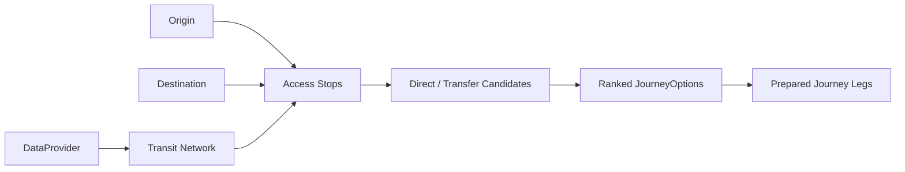

# 04 · Transit Navigation

<p align="center">
  
</p>

<p>
  <kbd>Origin → Destination</kbd>
  <kbd>Direct Route</kbd>
  <kbd>Transfer</kbd>
  <kbd>Journey Legs</kbd>
</p>

> **把起點、目的地、Bus／LRT stop order 串成 direct 或一程 transfer 的 journey options，並輸出可渲染的 leg sequence。**

## 功能

<p align="center">
  
</p>

- 建立 bus／LRT service network。
- 起點及目的地 access walking distance。
- Direct journey candidate。
- 跨 service transfer candidate。
- Journey ranking、badges、步行與候車時間。
- Walk／transit leg geometry preparation。



## 快速開始

```powershell
npm run build -w @onedirect/transit-navigation
npm run test -w @onedirect/transit-navigation
```

## 核心 API

| Export | 用途 |
| --- | --- |
| `buildTransitNetwork` | 由 routes／LRT／geometry 建立 services |
| `loadTransitNetwork` | 從 `DataProvider` 載入 network |
| `buildJourneyOptionsFromServices` | 純函數 journey planner |
| `calculateJourneyOptions` | Provider-backed journey planner |
| `prepareJourneyGeometry` | 補上 walking paths |
| `findBestJourney` | 回傳 ranked list 第一項 |
| `JourneyOption` / `JourneyLeg` | UI-ready journey contracts |

## 使用範例

```ts
import { MockDataProvider } from "@onedirect/data-fetcher-provider-layer";
import {
  calculateJourneyOptions,
  findBestJourney,
  prepareJourneyGeometry,
} from "@onedirect/transit-navigation";

const provider = new MockDataProvider();
const journeys = await calculateJourneyOptions(
  provider,
  { lat: 22.1513, lng: 113.5489 },
  { lat: 22.1569, lng: 113.5663 },
  { limit: 4 },
);

const best = findBestJourney(journeys);
if (best) {
  const prepared = await prepareJourneyGeometry(provider, best);
  console.log(prepared.legs);
}
```

## Custom `DataProvider`

```ts
import { MockDataProvider } from "@onedirect/data-fetcher-provider-layer";
import { calculateJourneyOptions } from "@onedirect/transit-navigation";

class HostNavigationProvider extends MockDataProvider {
  readonly id = "host-navigation";

  override getRouteGeometries() {
    return this.hostGeometryClient.readAll();
  }

  override getWalkingPath(from: Coordinate, to: Coordinate) {
    return this.hostWalkingClient.route(from, to);
  }
}
```

> Navigation 不接受 endpoint、token 或 vendor payload。真实 geometry／walking service 必須由 host provider 映射成 shared contracts。

## AI 協作

修改 network、transfer 或 geometry 前，閱讀 [`AGENTS.md`](./AGENTS.md)。
