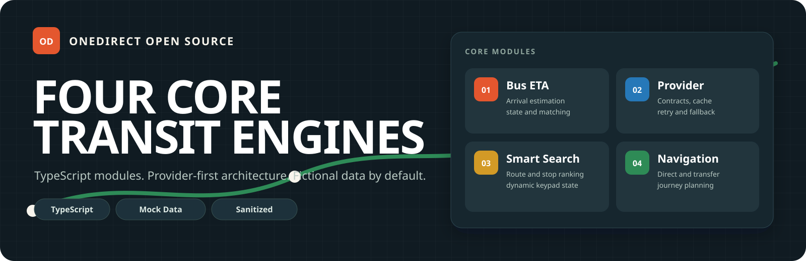
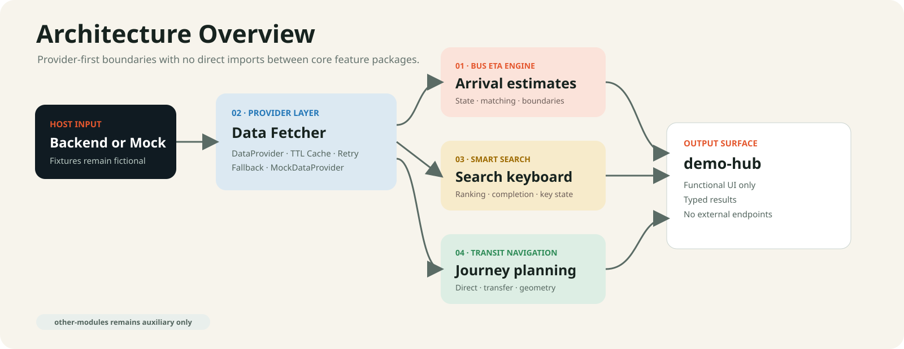
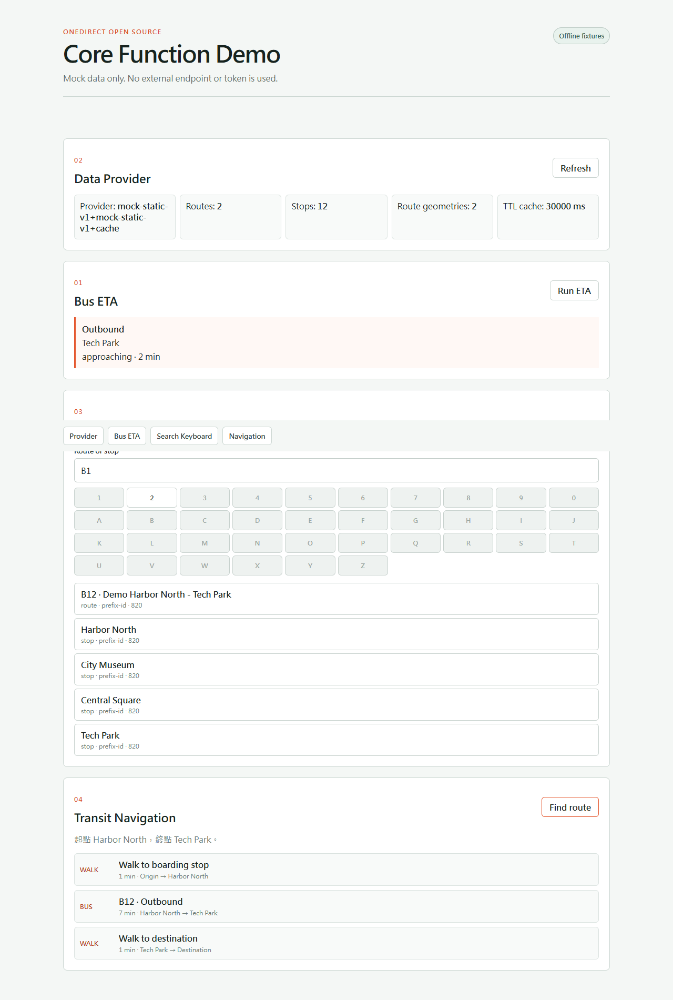
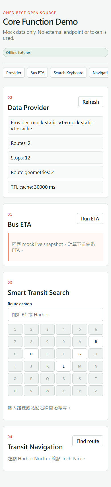
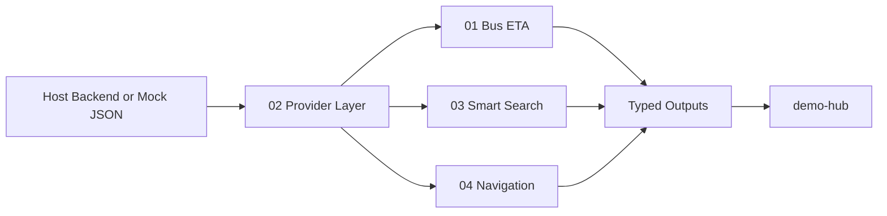

# 🚍 OneDirect Open Source

<p align="center">
  
</p>

<p align="right">
  <a href="./README.md">繁體中文</a> · <strong>English</strong>
</p>

<p>
  <kbd>TypeScript</kbd>
  <kbd>Provider First</kbd>
  <kbd>Mock Data</kbd>
  <kbd>Function First</kbd>
  <kbd>Apache-2.0</kbd>
</p>

> **Four focused transit engines as independent packages, with all auxiliary features grouped under `other-modules`.**
>
> OneDirect is a sanitized open-source transit toolkit. It builds, tests, and runs entirely on fictional mock data without real endpoints, tokens, or third-party backends.

## 📊 Project Status

| Item | Status |
| --- | --- |
| Version | `0.1.0` |
| License | Apache License 2.0 |
| Runtime | Node.js 20+ |
| Language | TypeScript strict mode |
| Default data source | Offline fictional fixtures |
| Workspaces | 7 |
| Unit tests | 40 passing |
| Security scan | 120 product files passing |
| Last verified | 2026-11-21 |

## 🧭 Contents

- [Overview](#overview)
- [Core Modules](#core-modules)
- [Feature Demo](#demo)
- [Quick Start](#quick-start)
- [Architecture](#architecture)
- [DataProvider](#provider)
- [API Showcase](#api-showcase)
- [Output Contracts](#output-contracts)
- [Configuration](#configuration)
- [Feature Status](#feature-status)
- [Security](#security)
- [Community and Help](#community)
- [Compatibility and Performance](#compatibility-and-support)
- [Threat Model](#threat-model)
- [Testing Matrix](#testing-matrix)
- [Quality](#quality)
- [End-to-End Example](#end-to-end-example)
- [Project Layout](#structure)
- [Documentation](#documentation)
- [Troubleshooting](#troubleshooting)
- [FAQ](#faq)
- [Roadmap](#roadmap)
- [Governance](#governance)
- [Release Checklist](#release-checklist)
- [Contributing](#contributing)
- [License](#license)

<a id="overview"></a>

## 🌐 Overview

<p align="center">
  
</p>

Transit applications often mix ETA logic, search behavior, navigation, and data access into operator-specific UI code. OneDirect turns the reusable parts into typed, testable packages.

| Goal | Implementation |
| --- | --- |
| Modular | Four core features, each exposed as a workspace |
| Replaceable | All external data enters through `DataProvider` |
| Deterministic | Fixed clocks, fixtures, and sorting |
| Safe to publish | No real endpoints, secrets, cookies, or scraping |
| Standalone-ready | Every core can become its own repository |
| Functional demo | One demo hub exercises all four engines |

## 🧩 Core Modules

| Module | Responsibility | Main Output | Documentation |
| --- | --- | --- | --- |
| **01 Bus ETA Engine** | ETA state, arrival estimation, direction matching | `EtaState`, `StopArrivalEstimate[]` | [English](./01-bus-eta-engine/README.en.md) · [繁體中文](./01-bus-eta-engine/README.md) |
| **02 Data Fetcher & Provider Layer** | Contracts, mock data, cache, retry, fallback | `DataProvider` | [English](./02-data-fetcher-provider-layer/README.en.md) · [繁體中文](./02-data-fetcher-provider-layer/README.md) |
| **03 Smart Transit Search Keyboard** | Route/stop search, ranking, completions, key state | `SearchResult[]`, `KeyboardState` | [English](./03-smart-transit-search-keyboard/README.en.md) · [繁體中文](./03-smart-transit-search-keyboard/README.md) |
| **04 Transit Navigation** | Direct/transfer journeys and legs | `JourneyOption[]` | [English](./04-transit-navigation/README.en.md) · [繁體中文](./04-transit-navigation/README.md) |

### Other Modules

- [Geofencing Engine](./other-modules/geofencing-engine/README.en.md)
- [Map Viewport UI](./other-modules/map-viewport-ui/README.en.md)
- [Demo Hub](./other-modules/demo-hub/)

<a id="demo"></a>

## 🎬 Feature Demo

The demo hub intentionally keeps the UI minimal:

1. Provider, cache, route, stop, and geometry counts.
2. Downstream ETA from a live snapshot.
3. Route and stop search with dynamic keyboard availability.
4. Journey legs from Harbor North to Tech Park.

<table>
  <tr>
    <td width="64%">
      
    </td>
    <td width="36%">
      
    </td>
  </tr>
</table>

<a id="quick-start"></a>

## 🚀 Quick Start

| Tool | Version |
| --- | --- |
| Node.js | 20+ |
| npm | 10+ |

```powershell
npm install
npm run verify
npm run dev
```

The demo is available at `localhost:4173` and requires no `.env` file or external service.

<a id="architecture"></a>

## 🏗️ Architecture



| Boundary | Rule |
| --- | --- |
| Shared contracts | Only `02` provides them |
| Core isolation | `01`, `03`, and `04` never import each other |
| Auxiliary isolation | `other-modules` cannot become a core dependency |
| Network | Only a host-owned provider performs it |
| UI | Renders typed results and captures input |

<a id="provider"></a>

## 🔌 DataProvider

```ts
import {
  MockDataProvider,
  type DataProvider,
} from "@onedirect/data-fetcher-provider-layer";

const provider: DataProvider = new MockDataProvider();

const [routes, stops, geometry] = await Promise.all([
  provider.getRoutes(),
  provider.getStops(),
  provider.getRouteGeometries(),
]);
```

HTTP, databases, authentication, cache policy, retries, and secrets belong in the host application or a provider wrapper.

## 🧪 API Showcase

### Bus ETA

```ts
import {
  deriveEtaState,
  estimateSnapshotArrivals,
  matchLiveRoute,
} from "@onedirect/bus-eta-engine";
```

The pipeline progresses from a live snapshot to direction matching, stop estimates, and a user-facing countdown state.

### Smart Search

```ts
import {
  SmartTransitSearchController,
  createSearchIndex,
} from "@onedirect/smart-transit-search-keyboard";

const index = await createSearchIndex(provider);
const search = new SmartTransitSearchController(index);
```

### Navigation

```ts
import { calculateJourneyOptions } from "@onedirect/transit-navigation";

const journeys = await calculateJourneyOptions(
  provider,
  origin,
  destination,
);
```

### Provider Wrappers

```ts
import {
  CachedDataProvider,
  FallbackDataProvider,
} from "@onedirect/data-fetcher-provider-layer";
```

## 📦 Output Contracts

| Package | Main output | Stability |
| --- | --- | --- |
| Bus ETA | `EtaSnapshot`, `EtaState`, `StopArrivalEstimate[]` | Typed public API |
| Provider | `DataProvider`, wrappers | Core contract |
| Search | `SearchResult[]`, `KeyboardState` | Typed public API |
| Navigation | `JourneyOption[]`, `JourneyLeg[]` | Typed public API |
| Geofencing | `NearbyStop[]` | Auxiliary API |
| Map UI | React component and theme helpers | Auxiliary UI |

## ⚙️ Configuration

| Variable | Default | Scope |
| --- | --- | --- |
| `DATA_PROVIDER` | `mock` | Host provider selection |
| `PROVIDER_CACHE_TTL_MS` | `30000` | Cache TTL |
| `PROVIDER_RETRY_MAX_ATTEMPTS` | `3` | Retry policy |
| `PROVIDER_RETRY_BASE_DELAY_MS` | `100` | Retry backoff |
| `VITE_MAPBOX_ACCESS_TOKEN` | empty | Optional map |
| `VITE_MAPBOX_STYLE_LIGHT` | empty | Optional map |
| `VITE_MAPBOX_STYLE_DARK` | empty | Optional map |

All defaults work without external services. Secret values must remain outside the repository.

## ✅ Feature Status

| Capability | Status |
| --- | ---: |
| Offline ETA demo | Complete |
| Provider cache and retry | Complete |
| Search and dynamic keyboard | Complete |
| Direct and one-transfer navigation | Complete |
| Optional map viewport | Complete |
| Bilingual module documentation | Complete |
| Standalone package CI | Planned |
| Multi-transfer routing | Planned |
| Fuzzy typo search | Planned |

<a id="security"></a>

## 🔒 Security

> **Never commit real endpoints, government targets, scraper selectors, headers, signing logic, IPs, tokens, cookies, or private domains.**

```powershell
npm run sanitize
```

- `.env` and `.env.local` are ignored.
- `.env.example` contains no values.
- All fixtures are fictional.
- Generated and local-only directories are ignored.
- `npm audit` currently reports zero vulnerabilities.

See [SECURITY.md](./SECURITY.md).

<a id="quality"></a>

## 📈 Quality

| Command | Purpose |
| --- | --- |
| `npm run build` | Build all workspaces |
| `npm test` | Run unit tests |
| `npm run sanitize` | Scan for sensitive data |
| `npm run verify` | Sanitize, build, and test |

Current baseline: 7 workspaces, 6 test packages, 40 unit tests, zero warnings, and zero known dependency vulnerabilities.

<a id="structure"></a>

## 🏗️ Project Layout

```text
OneDirect-OpenSource/
├── 01-bus-eta-engine/
├── 02-data-fetcher-provider-layer/
├── 03-smart-transit-search-keyboard/
├── 04-transit-navigation/
├── other-modules/
├── assets/readme/
├── scripts/
├── AGENTS.md
├── LICENSE
├── SECURITY.md
└── package.json
```

<a id="documentation"></a>

## 📚 Documentation

Full index: [docs/README.md](./docs/README.md)

### Getting Started

| Document | Description |
| --- | --- |
| [Installation](./docs/getting-started/INSTALLATION.md) | Requirements, install, build, test, demo |
| [Quick Start](./docs/getting-started/QUICK_START.md) | Minimal setup flow |
| [Provider Integration](./docs/getting-started/PROVIDER_INTEGRATION.md) | Host provider implementation |

### Architecture and Reference

| Document | Description |
| --- | --- |
| [Architecture](./docs/architecture/ARCHITECTURE.md) | System context and data flow |
| [Module Boundaries](./docs/architecture/MODULE_BOUNDARIES.md) | Ownership and dependencies |
| [API Reference](./docs/reference/API_REFERENCE.md) | Public APIs |
| [Environment](./docs/reference/ENVIRONMENT.md) | Environment variables |
| [Compatibility](./docs/reference/COMPATIBILITY.md) | Runtime support |

### Operations and Project

| Document | Description |
| --- | --- |
| [Testing](./docs/operations/TESTING.md) | Tests and quality gates |
| [Troubleshooting](./docs/operations/TROUBLESHOOTING.md) | Common errors |
| [Demo Guide](./docs/operations/DEMO_GUIDE.md) | Demo Hub usage |
| [Release Checklist](./docs/operations/RELEASE_CHECKLIST.md) | Pre-release audit |
| [Roadmap](./docs/project/ROADMAP.md) | Planned capabilities |
| [FAQ](./docs/project/FAQ.md) | Common questions |
| [Changelog](./docs/project/CHANGELOG.md) | Version history |

### Project Policies

| Document | Description |
| --- | --- |
| [AGENTS.md](./AGENTS.md) | AI architecture and safety |
| [CONTRIBUTING.md](./CONTRIBUTING.md) | Contribution workflow |
| [CODE_OF_CONDUCT.md](./CODE_OF_CONDUCT.md) | Community behavior |
| [SECURITY.md](./SECURITY.md) | Security policy |
| [LICENSE](./LICENSE) | Apache-2.0 |

<a id="contributing"></a>

## 🤝 Contributing

1. Read the relevant `AGENTS.md`.
2. Create a feature branch.
3. Add focused tests.
4. Run `npm run verify`.
5. Open a pull request describing contract and behavior impact.

Production payloads and private credentials are never accepted as fixtures.

## 🧱 Compatibility and Support

| Area | Current policy |
| --- | --- |
| Node.js | 20 and newer |
| npm | 10 and newer |
| TypeScript | Strict mode |
| Module format | ESM |
| UI runtime | React 18 in the optional map module |
| Build system | TypeScript compiler and Vite |
| Data transport | Host supplied |
| Browser support | Current evergreen browsers for UI demos |
| Deno and Bun | Not yet verified |

Core algorithms remain browser-safe and Node-compatible. UI packages stay isolated so a backend-only consumer does not need React.

## ⚡ Performance Profile

- Retrieval and parsing are separated from display work.
- Search ranking is linear in the number of candidates.
- Navigation candidates are bounded before ranking.
- TTL cache prevents repeated provider reads.
- Geometry is prepared only for the selected journey.
- Clustering is a deterministic pure function.

Host applications can add database-backed providers, paginated search indexes, or advanced spatial indexes without changing public contracts.

## 🛡️ Threat Model

| Risk | Mitigation |
| --- | --- |
| Secret accidentally committed | Sanitizer, `.gitignore`, fictional fixtures |
| Vendor endpoint copied into source | Provider boundary and scanner |
| Live payload contains private data | Allowlisted parsers and fictional fixtures |
| UI receives server credentials | Injected provider boundary |
| Retry overloads a backend | Bounded attempts and delay |
| Stale cache appears fresh | TTL and explicit stale state |
| Wrong route direction displays ETA | Coverage matching with `null` failure |
| User location logged | No location logging in core packages |

## 🧪 Testing Matrix

| Layer | Verified behavior |
| --- | --- |
| Provider | Defensive copies, TTL, retry, fallback, reload |
| ETA | Parsing, state, vehicle movement, direction |
| Search | Normalization, ranking, completion, key state |
| Navigation | Direct, transfer, unreachable, geometry |
| Geofencing | Distance, validation, radius, nearest route |
| Map UI | Projection, clustering threshold, theme tokens |
| Repository | Sanitization, TypeScript, Vite builds |

## 🧵 End-to-End Example

```ts
import {
  CachedDataProvider,
  MockDataProvider,
} from "@onedirect/data-fetcher-provider-layer";
import {
  estimateSnapshotArrivals,
  matchLiveRoute,
} from "@onedirect/bus-eta-engine";
import { searchTransit } from "@onedirect/smart-transit-search-keyboard";
import { calculateJourneyOptions } from "@onedirect/transit-navigation";

const provider = new CachedDataProvider(new MockDataProvider(), 30_000);
const searchResults = await searchTransit(provider, "B1");
const route = await provider.getRoute("B12");
const live = await provider.getLiveRoute("B12", 0);

if (route && live) {
  const match = matchLiveRoute(route, live);
  if (match) {
    const direction = route.directions[match.directionIndex]!;
    console.log({
      searchResults,
      estimates: estimateSnapshotArrivals(direction, live),
    });
  }
}

console.log(await calculateJourneyOptions(
  provider,
  { lat: 22.1513, lng: 113.5489 },
  { lat: 22.1569, lng: 113.5663 },
));
```

## 🔁 Module Lifecycle

1. Confirm the owning module.
2. Determine whether the shared contract changes.
3. Update the provider layer and mock fixtures.
4. Implement behavior in the owning module.
5. Add unit tests and edge cases.
6. Update both README languages.
7. Run `npm run verify`.
8. Review dependency direction before committing.

## 🧯 Troubleshooting

### `npm run dev` fails

Run `npm run build` first. The demo imports compiled workspace packages.

### A package cannot resolve another `@onedirect` package

Run `npm install` at the root to rebuild workspace symlinks.

### CI behaves differently from local

Check timezone, locale, current clock usage, and line endings. Time-sensitive tests must accept a fixed `now`.

### TypeScript cannot find a JSON fixture

Confirm `resolveJsonModule` and the package tsconfig include list.

### The map is blank

The default demo must work without Mapbox. A real basemap requires host-injected SDK, token, and styles.

## ❓ FAQ

### Is this a production API client?

No. It is a reference architecture and reusable algorithm library. Production integration belongs in a host provider.

### Can I reuse one module?

Yes. Every numbered module has its own package, fixtures, tests, and documentation.

### Why are fixtures fictional?

Fictional data keeps the repository safe and makes tests deterministic.

### Why is the provider layer a core module?

It defines the contracts shared by every other module.

### Does it support real-time updates?

The contracts support observed snapshots. Polling, streaming, and scheduling belong to the host provider.

### How do I add a transit mode?

Change the contracts first, extend fixtures, then update modules that need the new mode.

### Do tests perform network calls?

No. They use local fixtures and mocked providers.

## 🗺️ Roadmap

### Near term

- [ ] Standalone package smoke tests.
- [ ] GitHub Actions verification workflow.
- [ ] Generated API documentation.
- [ ] More fictional ETA and transfer cases.

### Later

- [ ] Publish each core with semantic versioning.
- [ ] Multi-city provider examples.
- [ ] Route-network benchmarks.
- [ ] Machine-readable contract documentation.

## ⚖️ Governance

- Security and privacy take precedence over feature speed.
- Core boundaries require explicit review.
- Production integrations stay outside public cores.
- Tests and bilingual documentation are part of the definition of done.
- Shared-contract breaking changes require a versioning plan.

## 🚢 Release Checklist

- [ ] `npm ci`
- [ ] `npm run verify`
- [ ] `npm audit`
- [ ] `git diff --cached --check`
- [ ] Confirm `.env` files are not tracked.
- [ ] Confirm both README languages.
- [ ] Confirm Apache-2.0 metadata.
- [ ] Review `git status`.

## 🙏 Acknowledgments

OneDirect Open Source is built around the idea that transit logic should be testable, replaceable, and safe to share. Thanks to every contributor and AI coding agent that respects module boundaries and keeps production data out of public fixtures.

<a id="license"></a>

<a id="community"></a>

## 📧 Community & Help

> Everything in one place: join the public channels, contribute, or report a problem.

| Channel | Where / how |
| --- | --- |
| 💬 **WhatsApp Channel** | [Join OneDirect on WhatsApp](https://whatsapp.com/channel/0029VbE05XjDp2QCXyMP3Y04) |
| ✈️ **Telegram Group** | [Join OneDirect on Telegram](https://t.me/+HCNCdc0Kfzg2ZDc1) |
| 🤝 **Contribute** | [CONTRIBUTING.md](./CONTRIBUTING.md) |
| 📄 **Community guide** | [COMMUNITY.md](./COMMUNITY.md) |
| 🛡️ **Security report** | Follow [SECURITY.md](./SECURITY.md), never post secrets publicly |
| 💚 **Support the project** | Star the repository, improve docs, or contribute tested fixtures |

> Community channels are public. Never post credentials, production payloads, private locations, or unsanitized data.

## 📄 License

Apache License 2.0. See [LICENSE](./LICENSE).

Copyright 2026 OneDirect contributors.

---

<p align="center">
  <a href="#onedirect-open-source">Back to top</a>
</p>
