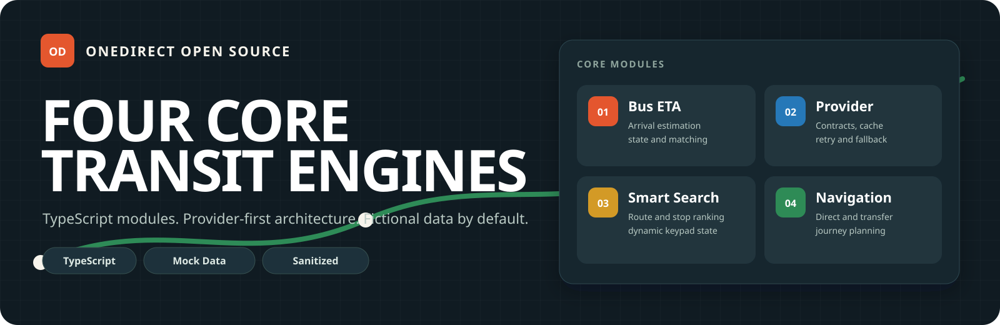
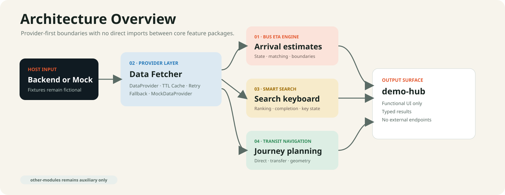
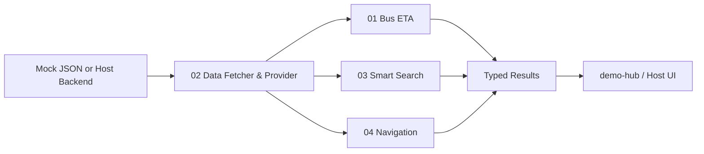
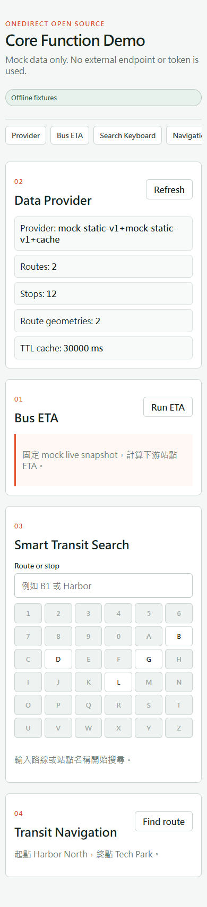

# OneDirect Open Source

<p align="center">
  
</p>

<p>
  <kbd>TypeScript</kbd>
  <kbd>Provider First</kbd>
  <kbd>Mock Data</kbd>
  <kbd>Function First</kbd>
  <kbd>Sanitized</kbd>
</p>

> **四個核心功能獨立成 package，其餘輔助功能集中到 `other-modules`。**
>
> 預設使用完全虛構的 Mock Data；不需要真實 endpoint、token、cookie 或第三方後端即可 build、test 與啟動 Demo。

## 目錄

- [專案結構](#structure)
- [四個核心功能](#core-modules)
- [快速開始](#quick-start)
- [功能 Demo](#demo)
- [依賴邊界](#boundaries)
- [安全與去敏化](#security)
- [獨立抽離](#extract)

<a id="structure"></a>

## 專案結構

<p align="center">
  
</p>

```text
OneDirect-OpenSource/
├── 01-bus-eta-engine/
├── 02-data-fetcher-provider-layer/
├── 03-smart-transit-search-keyboard/
├── 04-transit-navigation/
├── other-modules/
│   ├── geofencing-engine/
│   ├── map-viewport-ui/
│   └── demo-hub/
├── scripts/
├── AGENTS.md
├── SECURITY.md
├── .env.example
└── package.json
```

<a id="core-modules"></a>

## 四個核心功能

| Folder | 核心功能 | 主要 Output |
| --- | --- | --- |
| [`01-bus-eta-engine`](./01-bus-eta-engine/README.md) | ETA parsing、countdown state、vehicle-to-stop estimation、direction matching | `EtaSnapshot`、`EtaState`、`StopArrivalEstimate[]`、`DirectionMatch` |
| [`02-data-fetcher-provider-layer`](./02-data-fetcher-provider-layer/README.md) | DataProvider、Mock provider、TTL cache、retry、fallback、shared contracts | `DataProvider`、`MockDataProvider`、cached／fallback providers |
| [`03-smart-transit-search-keyboard`](./03-smart-transit-search-keyboard/README.md) | Route／stop search、ranking、prefix completion、dynamic keyboard state | `SearchResult[]`、`KeyboardState` |
| [`04-transit-navigation`](./04-transit-navigation/README.md) | Direct／transfer journey、walk access、leg sequence、journey geometry | `JourneyOption[]`、`JourneyLeg[]` |

### `other-modules/`

| Folder | 用途 |
| --- | --- |
| [`geofencing-engine`](./other-modules/geofencing-engine/README.md) | 距離、半徑搜尋與最近站點 |
| [`map-viewport-ui`](./other-modules/map-viewport-ui/README.md) | 輔助性的地圖 viewport、clustering 與 theme |
| [`demo-hub`](./other-modules/demo-hub/) | 功能優先的簡潔整合 Demo |

## 資料流



<a id="quick-start"></a>

## 快速開始

### 1. Clone 並進入專案

```powershell
cd OneDirect-OpenSource
```

### 2. 安裝

```powershell
npm install --no-package-lock
```

### 3. 驗證並啟動

```powershell
npm run verify
npm run dev
```

`npm run verify` 會執行 sanitize、7 個 workspace build 與所有核心 unit tests。Demo 位於 `localhost:4173`。

<a id="demo"></a>

## 功能 Demo

`other-modules/demo-hub` 提供四個簡潔 panel：

1. Provider health、cache 與 mock data counts。
2. Bus ETA 的下游站點倒數。
3. Smart Search Keyboard 的路線／站點搜尋及動態按鍵。
4. Transit Navigation 的直接路線與 leg sequence。

> Demo 只用來觸發功能與顯示 typed output，不追求 production UI 或真實地圖資料。

<table>
  <tr>
    <td width="64%">
      
    </td>
    <td width="36%">
      
    </td>
  </tr>
</table>

<a id="boundaries"></a>

## 依賴邊界

```text
02-data-fetcher-provider-layer
        ↑
        ├── 01-bus-eta-engine
        ├── 03-smart-transit-search-keyboard
        └── 04-transit-navigation

other-modules
├── geofencing-engine ── depends on 02
├── map-viewport-ui ──── depends on 02
└── demo-hub ─────────── depends on 01, 02, 03, 04
```

- 四個核心 module 不互相直接 import。
- `02` 是唯一 shared contracts、mock data、cache 與 fault-tolerance foundation。
- `other-modules` 不得成為核心 module 的上游 dependency。
- 真實 backend 由宿主應用實作 `DataProvider`，再注入各 module。

<a id="security"></a>

## 安全與去敏化

> **公開 repo 禁止出現真實政府／第三方 endpoint、爬蟲 selector、自訂 request header、簽名邏輯、IP、Token、Cookie 或私有域名。**

```powershell
npm run sanitize
```

安全文件：[SECURITY.md](./SECURITY.md)
AI 開發規範：[AGENTS.md](./AGENTS.md)

<a id="extract"></a>

## 獨立抽離

每個核心 folder 都可抽成獨立 GitHub Repo。獨立版本需要以下其中一種 shared dependency：

1. 發佈 `02-data-fetcher-provider-layer` 為 npm package。
2. 以 monorepo submodule／vendored package 引入。
3. 在 standalone repo 保留相同 contracts，並維持版本相容。

`01`、`03`、`04` 都有 module-local fixtures、tests 與 demo-ready API，不依賴其他核心 module。
