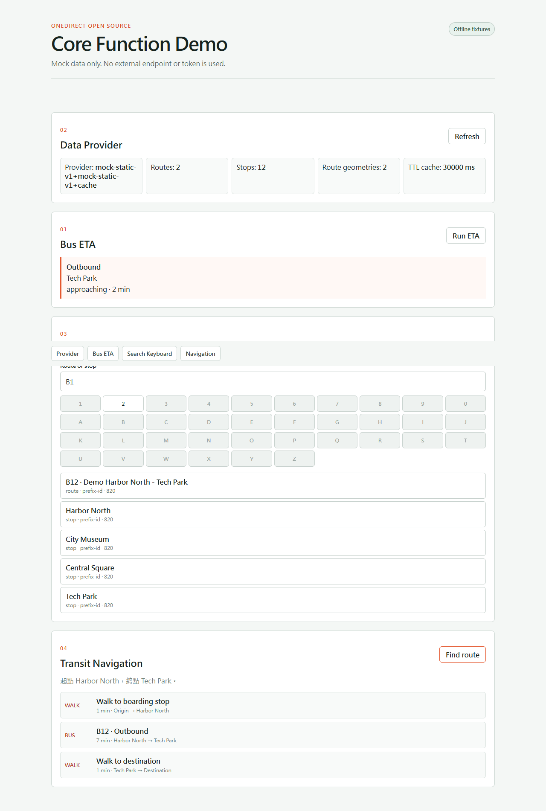
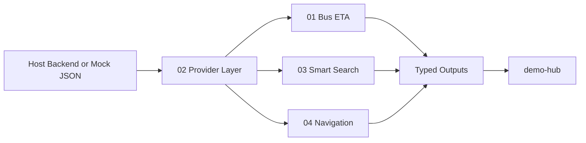

# 🚍 OneDirect Open Source

<p align="center">
  
</p>

<p align="right">
  <strong>繁體中文</strong> · <a href="./README.en.md">English</a>
</p>

<p>
  <kbd>TypeScript</kbd>
  <kbd>Provider First</kbd>
  <kbd>Mock Data</kbd>
  <kbd>Function First</kbd>
  <kbd>Apache-2.0</kbd>
</p>

> **四個核心 transit engines 各自獨立，其餘輔助功能集中到 `other-modules`。**
>
> 本專案是去敏化的開源交通運算 toolkit。預設只使用虛構 Mock Data，不需要真實 endpoint、Token 或第三方 backend，即可完成 build、test 與功能展示。

## 📊 專案狀態

| 項目 | 狀態 |
| --- | --- |
| Version | `0.1.0` |
| License | Apache License 2.0 |
| Runtime | Node.js 20+ |
| Language | TypeScript strict mode |
| Default data source | Offline fictional fixtures |
| Workspaces | 7 |
| Unit tests | 40 passing |
| Security scan | 120 product files passing |
| Last verified | 2026-11-21 |

## 🧭 目錄

- [專案總覽](#overview)
- [核心模組](#core-modules)
- [功能 Demo](#demo)
- [Quick Start](#quick-start)
- [架構與依賴](#architecture)
- [DataProvider](#provider)
- [API Showcase](#api-showcase)
- [Output Contracts](#output-contracts)
- [Configuration](#configuration)
- [Feature Status](#feature-status)
- [安全與去敏化](#security)
- [Community & Help](#community)
- [相容性與效能](#相容性與支援)
- [Threat Model](#threat-model)
- [測試矩陣](#測試矩陣)
- [測試與品質](#quality)
- [End-to-End 範例](#end-to-end-範例)
- [目錄結構](#structure)
- [文件索引](#documentation)
- [Troubleshooting](#troubleshooting)
- [FAQ](#faq)
- [Roadmap](#roadmap)
- [Governance](#governance)
- [Release Checklist](#release-checklist)
- [貢獻方式](#contributing)
- [License](#license)

<a id="overview"></a>

## 🌐 專案總覽

<p align="center">
  
</p>

交通應用常見問題是把 ETA、搜尋、導航及資料接入邏輯混在 UI 或特定 operator code 中。OneDirect 把最有重用價值的業務能力抽成獨立、typed、可測試的 packages。

| 設計目標 | 實作方式 |
| --- | --- |
| Modular | 四個核心功能各自是 npm workspace |
| Replaceable | 所有資料經 `DataProvider` 注入 |
| Deterministic | 固定 clock、fixtures 與 sorting |
| Safe to publish | 無真實 endpoint、Secret、Cookie 或 scraping logic |
| Standalone-ready | 每個核心可獨立抽成 repository |
| Functional demo | `demo-hub` 可直接觸發全部核心 |

## 🧩 核心模組

| Module | 解決問題 | 主要 Output | 文件 |
| --- | --- | --- | --- |
| **01 Bus ETA Engine** | 到站時間、倒數狀態、segment estimation、direction matching | `EtaState`, `StopArrivalEstimate[]` | [中文](./01-bus-eta-engine/README.md) · [English](./01-bus-eta-engine/README.en.md) |
| **02 Data Fetcher & Provider Layer** | Contracts、Mock、cache、retry、fallback | `DataProvider` | [中文](./02-data-fetcher-provider-layer/README.md) · [English](./02-data-fetcher-provider-layer/README.en.md) |
| **03 Smart Transit Search Keyboard** | 路線／站點搜尋、ranking、completion、keyboard state | `SearchResult[]`, `KeyboardState` | [中文](./03-smart-transit-search-keyboard/README.md) · [English](./03-smart-transit-search-keyboard/README.en.md) |
| **04 Transit Navigation** | 起終點、direct／transfer、legs、geometry | `JourneyOption[]` | [中文](./04-transit-navigation/README.md) · [English](./04-transit-navigation/README.en.md) |

### Other Modules

- [Geofencing Engine](./other-modules/geofencing-engine/README.md)：距離、半徑搜尋與最近站點。
- [Map Viewport UI](./other-modules/map-viewport-ui/README.md)：可選 clustering、theme 與 Mapbox adapter。
- [Demo Hub](./other-modules/demo-hub/)：功能優先的整合介面。

<a id="demo"></a>

## 🎬 功能 Demo

Demo 不追求 production UI，只用最少介面證明四個 core 可以一起運作：

1. 顯示 Provider、cache、route、stop 與 geometry 數量。
2. 由 live snapshot 計算下游 ETA。
3. 即時搜尋路線／站點並更新 virtual keyboard。
4. 計算 Harbor North 到 Tech Park 的 journey legs。

<table>
  <tr>
    <td width="64%">
      
    </td>
    <td width="36%">
      
    </td>
  </tr>
</table>

<a id="quick-start"></a>

## 🚀 Quick Start

### Requirements

| Tool | Version |
| --- | --- |
| Node.js | 20+ |
| npm | 10+ |

### 1. Install

```powershell
npm install
```

### 2. Verify

```powershell
npm run verify
```

### 3. Run

```powershell
npm run dev
```

Demo 位於 `localhost:4173`，不需要 `.env` 或 external services。

<a id="architecture"></a>

## 🏗️ 架構與依賴



| Boundary | Rule |
| --- | --- |
| Shared contracts | 只由 `02` 提供 |
| Core isolation | `01`、`03`、`04` 不互相 import |
| Auxiliary isolation | `other-modules` 不得成為核心上游 |
| Network | 只在 host-owned `DataProvider` 實作 |
| UI | 只負責輸入及呈現 typed output |

<a id="provider"></a>

## 🔌 DataProvider

```ts
import {
  MockDataProvider,
  type DataProvider,
} from "@onedirect/data-fetcher-provider-layer";

const provider: DataProvider = new MockDataProvider();

const [routes, stops, geometry] = await Promise.all([
  provider.getRoutes(),
  provider.getStops(),
  provider.getRouteGeometries(),
]);
```

真實 HTTP、database、authentication、cache、retry 與 secrets management 應留在 host application 或 provider wrapper。

## 🧪 API Showcase

### Bus ETA

```ts
import {
  deriveEtaState,
  estimateSnapshotArrivals,
  matchLiveRoute,
} from "@onedirect/bus-eta-engine";
```

```text
Live snapshot
  → direction matching
  → stop arrival estimation
  → countdown state
```

### Smart Search

```ts
import {
  SmartTransitSearchController,
  createSearchIndex,
} from "@onedirect/smart-transit-search-keyboard";

const index = await createSearchIndex(provider);
const search = new SmartTransitSearchController(index);
```

### Navigation

```ts
import { calculateJourneyOptions } from "@onedirect/transit-navigation";

const journeys = await calculateJourneyOptions(
  provider,
  origin,
  destination,
);
```

### Provider Wrappers

```ts
import {
  CachedDataProvider,
  FallbackDataProvider,
} from "@onedirect/data-fetcher-provider-layer";
```

## 📦 Output Contracts

| Package | Main output | Stability |
| --- | --- | --- |
| Bus ETA | `EtaSnapshot`, `EtaState`, `StopArrivalEstimate[]` | Typed public API |
| Provider | `DataProvider`, provider wrappers | Core contract |
| Search | `SearchResult[]`, `KeyboardState` | Typed public API |
| Navigation | `JourneyOption[]`, `JourneyLeg[]` | Typed public API |
| Geofencing | `NearbyStop[]` | Auxiliary typed API |
| Map UI | React component and theme helpers | Auxiliary UI API |

## ⚙️ Configuration

| Variable | Default | Scope |
| --- | --- | --- |
| `DATA_PROVIDER` | `mock` | Host data selection |
| `PROVIDER_CACHE_TTL_MS` | `30000` | Provider cache |
| `PROVIDER_RETRY_MAX_ATTEMPTS` | `3` | Retry policy |
| `PROVIDER_RETRY_BASE_DELAY_MS` | `100` | Retry backoff |
| `VITE_MAPBOX_ACCESS_TOKEN` | empty | Optional host map |
| `VITE_MAPBOX_STYLE_LIGHT` | empty | Optional host map |
| `VITE_MAPBOX_STYLE_DARK` | empty | Optional host map |

> 所有 default values 都不需要外部服務；空白值必須保持空白，不可提交 secret。

## ✅ Feature Status

| Capability | Status |
| --- | ---: |
| Offline ETA demo | Complete |
| Provider cache and retry | Complete |
| Search and dynamic keyboard | Complete |
| Direct and one-transfer navigation | Complete |
| Optional map viewport | Complete |
| Bilingual module documentation | Complete |
| Standalone package CI | Planned |
| Multi-transfer routing | Planned |
| Fuzzy typo search | Planned |

<a id="security"></a>

## 🔒 安全與去敏化

> **禁止提交真實 endpoint、政府資料目標、scraper selector、Headers、簽名邏輯、IP、Token、Cookie 或 private domain。**

```powershell
npm run sanitize
```

目前保證：

- `.env`、`.env.local` 已在 `.gitignore`。
- `.env.example` 只包含空白變數名稱。
- Fixtures 全部虛構。
- `node_modules/`、`dist/`、`.test-dist/`、`artifacts/` 不進 Git。
- `npm audit` 為 0 vulnerabilities。

完整政策見 [SECURITY.md](./SECURITY.md)。

<a id="quality"></a>

## 📈 測試與品質

| Command | Purpose |
| --- | --- |
| `npm run build` | 7 個 workspace builds |
| `npm test` | Unit tests only |
| `npm run sanitize` | 敏感資料掃描 |
| `npm run verify` | sanitize + build + tests |

目前 baseline：

- 6 個 test packages。
- 40 個 unit tests。
- 0 build warnings。
- 0 known dependency vulnerabilities。

<a id="structure"></a>

## 🏗️ 目錄結構

```text
OneDirect-OpenSource/
├── 01-bus-eta-engine/
├── 02-data-fetcher-provider-layer/
├── 03-smart-transit-search-keyboard/
├── 04-transit-navigation/
├── other-modules/
│   ├── geofencing-engine/
│   ├── map-viewport-ui/
│   └── demo-hub/
├── assets/readme/
├── scripts/
├── AGENTS.md
├── LICENSE
├── SECURITY.md
└── package.json
```

<a id="documentation"></a>

## 📚 文件索引

完整文檔：[docs/README.md](./docs/README.md)

### Getting Started

| Document | Description |
| --- | --- |
| [Installation](./docs/getting-started/INSTALLATION.md) | Node/npm、install、build、test 及 demo |
| [Quick Start](./docs/getting-started/QUICK_START.md) | 最短啟動流程 |
| [Provider Integration](./docs/getting-started/PROVIDER_INTEGRATION.md) | Host `DataProvider` integration |

### Architecture & Reference

| Document | Description |
| --- | --- |
| [Architecture](./docs/architecture/ARCHITECTURE.md) | 系統、資料流及 component interaction |
| [Module Boundaries](./docs/architecture/MODULE_BOUNDARIES.md) | Ownership 與 dependency rules |
| [API Reference](./docs/reference/API_REFERENCE.md) | Public package APIs |
| [Environment](./docs/reference/ENVIRONMENT.md) | Environment variables |
| [Compatibility](./docs/reference/COMPATIBILITY.md) | Runtime and version support |

### Operations & Project

| Document | Description |
| --- | --- |
| [Testing](./docs/operations/TESTING.md) | Test matrix and quality gates |
| [Troubleshooting](./docs/operations/TROUBLESHOOTING.md) | 常見錯誤與修正 |
| [Demo Guide](./docs/operations/DEMO_GUIDE.md) | Demo Hub 操作 |
| [Release Checklist](./docs/operations/RELEASE_CHECKLIST.md) | 上傳前檢查 |
| [Roadmap](./docs/project/ROADMAP.md) | Planned capabilities |
| [FAQ](./docs/project/FAQ.md) | 常見問題 |
| [Changelog](./docs/project/CHANGELOG.md) | Version history |

### Project Policies

| Document | Description |
| --- | --- |
| [AGENTS.md](./AGENTS.md) | AI architecture and safety rules |
| [CONTRIBUTING.md](./CONTRIBUTING.md) | Contribution workflow |
| [CODE_OF_CONDUCT.md](./CODE_OF_CONDUCT.md) | Community behavior |
| [SECURITY.md](./SECURITY.md) | Security policy |
| [LICENSE](./LICENSE) | Apache-2.0 |

<a id="contributing"></a>

## 🤝 貢獻方式

1. 閱讀根目錄與目標 module 的 `AGENTS.md`。
2. 建立 feature branch。
3. 為每個行為變更加 tests。
4. 執行 `npm run verify`。
5. Pull Request 中說明 contract、fixture 與 UI 影響。

不接受 production payload、真實交通目標或私人 credentials 作為 fixtures。

## 🧱 相容性與支援

| 範圍 | 目前政策 |
| --- | --- |
| Node.js | 20 以上 |
| npm | 10 以上 |
| TypeScript | Strict mode |
| Module format | ESM |
| UI runtime | Optional map module 使用 React 18 |
| Build system | TypeScript compiler + Vite |
| Data transport | 由 host 提供 |
| Browser | UI Demo 支援現行 evergreen browsers |
| Deno / Bun | 尚未列入 verified contract |

核心 algorithms 保持 browser-safe 及 Node-compatible；UI package 則獨立，令 backend consumer 不需要 React。

## ⚡ 效能設計

- Retrieval、parsing 與 display 分離。
- Search ranking 對 candidates 數量呈線性。
- Navigation candidates 先限制再 ranking。
- TTL cache 減少重複 provider reads。
- 只為 selected journey 準備 geometry。
- Clustering 為 deterministic pure function。

如資料量很大，host application 可加入 database-backed provider、paginated search index 或更強 spatial index，而不改變 public contracts。

## 🛡️ Threat Model

| 風險 | 防線 |
| --- | --- |
| Secret 意外 commit | Sanitizer、`.gitignore`、虛構 fixtures |
| Vendor endpoint 被 copy | Provider boundary 與 scanner |
| Live payload 含私人資料 | Allowlisted parser 與 fictional fixtures |
| UI 拿到 server credential | Injected provider boundary |
| Retry 過度請求 backend | Bounded attempts + delay |
| 過期 cache 扮作即時 | TTL 及 explicit stale state |
| 錯誤 direction 顯示 ETA | Coverage matching，不足回 `null` |
| User location 被記錄 | Core packages 不 log location |

## 🧪 測試矩陣

| Layer | 驗證內容 |
| --- | --- |
| Provider | Defensive copies、TTL、retry、fallback、reload |
| ETA | Parsing、state、vehicle movement、direction |
| Search | Normalization、ranking、completion、key state |
| Navigation | Direct、transfer、unreachable、geometry |
| Geofencing | Distance、validation、radius、nearest route |
| Map UI | Projection、clustering、theme tokens |
| Repository | Sanitization、TypeScript、Vite builds |

## 🧵 End-to-End 範例

```ts
import {
  CachedDataProvider,
  MockDataProvider,
} from "@onedirect/data-fetcher-provider-layer";
import {
  estimateSnapshotArrivals,
  matchLiveRoute,
} from "@onedirect/bus-eta-engine";
import { searchTransit } from "@onedirect/smart-transit-search-keyboard";
import { calculateJourneyOptions } from "@onedirect/transit-navigation";

const provider = new CachedDataProvider(new MockDataProvider(), 30_000);
const searchResults = await searchTransit(provider, "B1");
const route = await provider.getRoute("B12");
const live = await provider.getLiveRoute("B12", 0);

if (route && live) {
  const match = matchLiveRoute(route, live);
  if (match) {
    const direction = route.directions[match.directionIndex]!;
    console.log({
      searchResults,
      estimates: estimateSnapshotArrivals(direction, live),
    });
  }
}

console.log(await calculateJourneyOptions(
  provider,
  { lat: 22.1513, lng: 113.5489 },
  { lat: 22.1569, lng: 113.5663 },
));
```

## 🔁 Module Lifecycle

1. 確認 owning module。
2. 判斷 shared contract 是否需要更新。
3. 更新 provider layer 及 mock fixtures。
4. 在 owning module 實作。
5. 加入 unit tests 及 edge cases。
6. 同步更新中英文 README。
7. 執行 `npm run verify`。
8. Commit 前 review dependency direction。

## 🧯 Troubleshooting

### `npm run dev` 失敗

先執行 `npm run build`；Demo 使用 compiled workspace packages。

### `@onedirect` package resolve 不到

在 root 重新執行 `npm install`，重建 workspace symlinks。

### CI 與本機結果不同

檢查 timezone、locale、current clock 及 line endings。時間測試必須使用 fixed `now`。

### TypeScript 找不到 JSON fixture

確認 `resolveJsonModule` 與 package tsconfig include。

### Mapbox UI 不顯示

Default demo 不需要 Mapbox。Real basemap 需要 host 注入 SDK、token 與 style。

## ❓ FAQ

### 這是 production transit API client 嗎？

不是。它是 reference architecture 與 reusable algorithm library；真實 integration 放在 host-owned provider。

### 可以只用其中一個 module 嗎？

可以。每個 numbered module 都有 package、tests、fixtures 與中英文文件。

### 為何 fixtures 必須虛構？

令 repo 可安全公開，亦令 tests deterministic、無需 credentials。

### 為何 Provider Layer 也是核心？

它定義所有 modules 共用的 contracts；獨立成 package 可清楚表達邊界。

### 支援 real-time updates 嗎？

Contracts 支援 observed snapshots；polling、streaming 及 scheduling 由 host provider 負責。

### 如何加入新 transit mode？

先更新 contracts 及 mock coverage，再修改需要理解該 mode 的 modules。

### Tests 會否發出 network request？

不會。全部使用 local fixtures 及 mocked provider。

## 🗺️ Roadmap

### Near term

- [ ] Standalone package smoke tests。
- [ ] GitHub Actions verification workflow。
- [ ] 由 exports 自動生成 API docs。
- [ ] 擴充 fictional ETA／transfer cases。

### Later

- [ ] 以 semantic versioning 發佈各 core。
- [ ] Multi-city provider examples。
- [ ] Route-network benchmark。
- [ ] Machine-readable contract docs。

## ⚖️ Governance

- Security 與 privacy 優先於功能速度。
- Core package boundaries 需要明確 review。
- Production integration 不屬於 public core。
- Tests 與雙語文件屬於 definition of done。
- Breaking shared-contract change 必須有 versioning plan。

## 🚢 Release Checklist

- [ ] `npm ci`
- [ ] `npm run verify`
- [ ] `npm audit`
- [ ] `git diff --cached --check`
- [ ] 確認 `.env` 未 tracked。
- [ ] 確認中英文 README links。
- [ ] 確認 Apache-2.0 metadata。
- [ ] Commit 前 review `git status`。

## 🙏 Acknowledgments

OneDirect Open Source 建基於一個原則：transit logic 應該可測試、可替換及可安全分享。感謝每位尊重 module boundaries 的開發者及 AI coding agents。

<a id="license"></a>

<a id="community"></a>

## 📧 Community & Help

> Everything in one place: join the public channels, contribute, or report a problem.

| Channel | Where / how |
| --- | --- |
| 💬 **WhatsApp Channel** | [Join OneDirect on WhatsApp](https://whatsapp.com/channel/0029VbE05XjDp2QCXyMP3Y04) |
| ✈️ **Telegram Group** | [Join OneDirect on Telegram](https://t.me/+HCNCdc0Kfzg2ZDc1) |
| 🤝 **Contribute** | [CONTRIBUTING.md](./CONTRIBUTING.md) |
| 📄 **Community guide** | [COMMUNITY.md](./COMMUNITY.md) |
| 🛡️ **Security report** | Follow [SECURITY.md](./SECURITY.md), never post secrets publicly |
| 💚 **Support the project** | Star the repository, improve docs, or contribute tested fixtures |

> Community channels are public. Never post credentials, production payloads, private locations, or unsanitized data.

## 📄 License

Apache License 2.0，詳見 [LICENSE](./LICENSE)。

Copyright 2026 OneDirect contributors.

---

<p align="center">
  <a href="#onedirect-open-source">Back to top</a>
</p>
