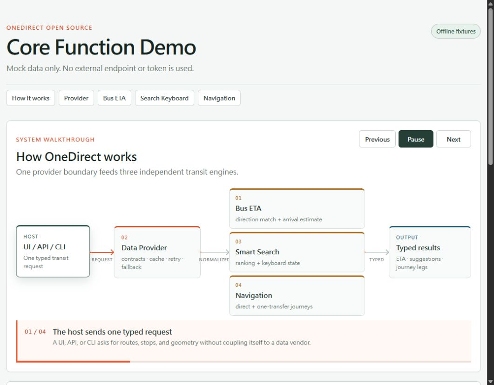
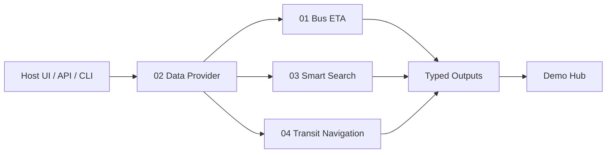

# 🔄 Operating Flow

<p align="right">
  <a href="../README.md">Docs Index</a> ·
  <a href="../../README.md">Project Home</a> ·
  <a href="../../other-modules/demo-hub/#how-it-works">Animated Demo</a>
</p>

<p align="center">
  
</p>

## 繁體中文

### 四段動畫

Demo Hub 第一頁提供自動播放的系統導覽，依次展示：

1. Host 發出單一 typed request。
2. `02` provider layer 處理 contract、cache、retry 及 fallback。
3. `01`、`03`、`04` 三個獨立引擎轉換資料。
4. Typed output 回到 Host UI。

可以暫停、前後切換。系統啟用 reduced motion 時會預設暫停。

### System map



### Request lifecycle

1. Host 只依賴 `DataProvider` contract。
2. Provider wrapper 可加入 TTL cache、retry 及 fallback。
3. `02` 將不同來源整理成同一套 typed transit data。
4. 各引擎只接收自己需要的 data，不處理 vendor authentication。
5. 引擎以 deterministic sorting 及固定 clock 完成運算。
6. Package 回傳公開 output contracts。
7. Host 選擇如何顯示、儲存或再組合結果。

### Engine responsibilities

| Package | Input | Processing | Output |
| --- | --- | --- | --- |
| `01 Bus ETA` | Route direction + live vehicle observations | Direction match、stop normalization、distance／speed ETA | `StopArrivalEstimate[]`、`EtaState` |
| `02 Provider` | Host-owned source or fictional fixtures | Contract validation、cache、retry、fallback | Typed transit data |
| `03 Smart Search` | Routes、stops、LRT lines／stations + query | Normalize、score、rank、completion | `SearchResult[]`、`KeyboardState` |
| `04 Navigation` | Transit network + origin／destination | Direct／one-transfer candidates、walking／waiting／ride time | `JourneyOption[]`、`JourneyLeg[]` |

### ETA estimate

`01` 以 live vehicle 所在路段、下一站、車速及 route stop 座標估算到站時間：

```text
target stop distance
  − travelled midpoint distance
  ÷ current vehicle speed
  = estimated minutes
```

Direction 或 station sequence 對不上時，不會假裝成功；關聯 ETA 可以是 `null`。

### Search behavior

`03` 先正規化 query，再按 exact ID、ID prefix、ID contains、name contains 分層評分。相同分數使用 stable deterministic order。Virtual keyboard 只啟用仍可形成有效 candidate 的按鍵。

### Journey planning

`04` 建立 bus／LRT service network，再搜尋 direct 及最多一次 transfer：

| 參數 | Default |
| --- | ---: |
| Walk speed | `78 m/min` |
| Bus estimate | `310 m/min` |
| LRT estimate | `520 m/min` |
| Bus wait | `4 min` |
| LRT wait | `3 min` |
| Origin access | `1,400 m` |
| Destination access | `1,600 m` |
| Transfer walk | `500 m` |
| Result limit | `8` |

Travel time 是 deterministic estimate。只有 selected journey 才 prepare walking geometry。

### Cache and failure boundaries

- Default provider TTL：`30,000 ms`。
- Retry default：最多 3 次，base delay `100 ms`。
- Provider failure 留在 `02`；fallback 不可泄漏 vendor details。
- Parser failure 是 typed domain error。
- ETA direction mismatch 回傳安全失敗，不顯示錯誤路線倒數。
- Navigation 找不到可達站點時回傳空陣列。
- Optional map UI failure 不影響四個核心 packages。

### Security boundary

Open Source demo 及 core packages 不使用真實 endpoint、token、cookie、auth header、IP、private domain、scraper selector 或 production payload。所有 fixtures 均為虛構資料。

## 🇬🇧 English

The Demo Hub opens with an animated walkthrough of the host request, provider boundary, three pure engines, and typed output. It can be paused and stepped forwards or backwards, and starts paused when reduced motion is requested.

The provider layer is the only shared data boundary. Bus ETA, smart search, and navigation remain independent packages with deterministic inputs, typed outputs, and explicit failure behavior. Cache, retry, and fallback belong to provider wrappers. Journey times use bounded deterministic estimates, and walking geometry is prepared only for the selected journey.

The public demo remains fully fictional. No production endpoints, credentials, cookies, headers, private domains, scraper logic, or real payloads are accepted.
