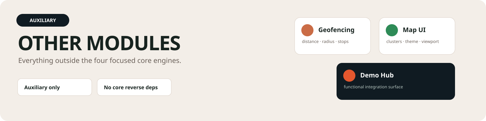
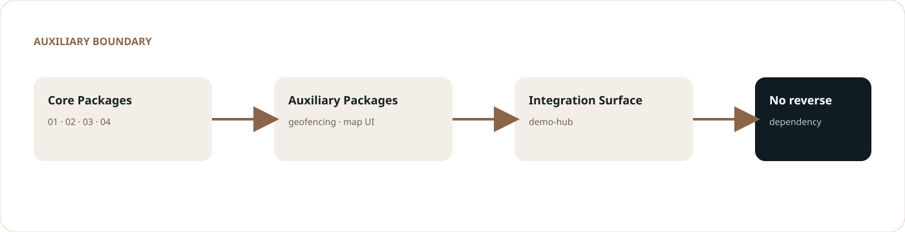

# 📚 Other Modules

<p align="center">
  
</p>

<p align="right">
  <a href="./README.md">繁體中文</a> · <strong>English</strong> ·
  <a href="../README.en.md">Project Home</a>
</p>

<p>
  <kbd>Auxiliary</kbd>
  <kbd>Optional UI</kbd>
  <kbd>Integration Demo</kbd>
  <kbd>Apache-2.0</kbd>
</p>

## 🧭 Contents

- [Contents](#contents-1)
- [Core Modules](#where-are-the-core-modules)
- [Dependency Rules](#dependency-rules)
- [Demo Hub](#demo-hub)
- [Development Workflow](#development-workflow)
- [Testing](#testing-strategy)
- [FAQ](#faq)
- [Security](#security)
- [License](#license)

> **All non-core and auxiliary modules live here. Core packages must never depend on this folder.**

## 🧭 Contents

<p align="center">
  
</p>

| Folder | Purpose | Core? | Documentation |
| --- | --- | --- | --- |
| `geofencing-engine/` | Distance, radius search, nearby stops | No | [English](./geofencing-engine/README.en.md) · [繁體中文](./geofencing-engine/README.md) |
| `map-viewport-ui/` | Clustering, themes, optional Mapbox | No | [English](./map-viewport-ui/README.en.md) · [繁體中文](./map-viewport-ui/README.md) |
| `demo-hub/` | Minimal integration UI | No | This overview |

## 🧩 Where Are the Core Modules?

The four cores live under `01-bus-eta-engine`, `02-data-fetcher-provider-layer`, `03-smart-transit-search-keyboard`, and `04-transit-navigation`.

## 🔒 Dependency Rules

- Geofencing and map UI may depend on the provider layer.
- Demo Hub may depend on every core package.
- Core packages may not import from `other-modules`.
- UI stays functional rather than decorative.

## 🎬 Demo Hub

The demo starts with a four-stage provider-first animation, then verifies provider metadata, ETA output, search suggestions, dynamic keyboard state, and journey legs.

```powershell
npm run dev
```

## ➕ Adding an Auxiliary Module

Create a standalone package, add it to the workspace list, preserve dependency direction, provide README and AGENTS files, add tests, and register build and test scripts in the root verification flow.

## 🔒 Security

- No real endpoints, tokens, cookies, headers, or private domains.
- All demo data remains fictional.
- No remote tile or map-style URLs.

## 🤖 AI Collaboration

Read [AGENTS.md](./AGENTS.md).

## 🧩 Choosing an Auxiliary Module

| Need | Module |
| --- | --- |
| Distance and nearest stops | Geofencing Engine |
| Map markers and clustering | Map Viewport UI |
| Integrated smoke test | Demo Hub |
| New helper capability | Create a new package here |

## 🌐 Why Keep Them Together?

Core packages have a stricter change and testing contract. Optional UI, distance utilities, and integration helpers are grouped here so consumers and AI agents can immediately distinguish core from auxiliary code.

## 📊 Maturity Matrix

| Module | Tests | Default network | Standalone |
| --- | --- | --- | --- |
| Geofencing | Yes | None | Yes |
| Map UI | Yes | None | Yes |
| Demo Hub | Build-tested | None | Integration only |

## 🔁 Development Workflow

Create the package, register the workspace, add only necessary dependencies, provide tests and bilingual docs, update verification scripts, and run the root suite.

## ✅ Testing Strategy

Utilities use unit tests. UI behavior is split into pure projection, clustering, and theme functions. Demo Hub is validated by a production Vite build.

## 🔒 Security Review

No real tile URLs, production payloads, tokens, scrape helpers, or remote telemetry are accepted.

## ❓ FAQ

### Can a core depend on these modules?

No. If a capability becomes foundational, move it into a deliberate core boundary.

### Is Demo Hub production UI?

No. It is an integration and smoke-test surface.

### Is Map UI required?

No. All core functionality works without Mapbox.

## 📄 License

Apache-2.0. See [LICENSE](../LICENSE).

---

<p align="center"><a href="#">Back to top</a></p>
