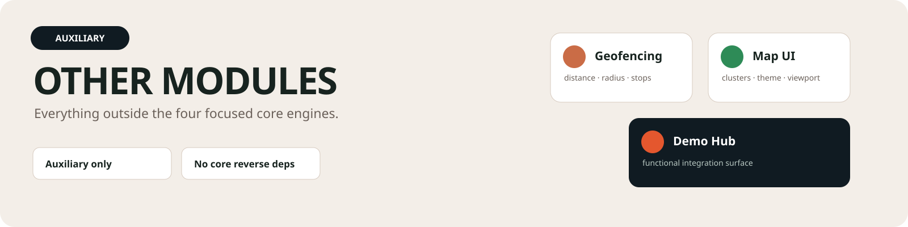

# Other Modules

<p align="center">
  
</p>

<p>
  <kbd>Auxiliary</kbd>
  <kbd>Optional UI</kbd>
  <kbd>Integration Demo</kbd>
</p>

> **所有非四大核心功能的輔助模組集中在這裡。**

## 內容

<p align="center">
  
</p>

| Folder | 用途 | 是否核心 |
| --- | --- | --- |
| `geofencing-engine/` | Haversine、半徑搜尋、最近站點 | 否 |
| `map-viewport-ui/` | Optional map viewport、clustering、theme | 否 |
| `demo-hub/` | 簡潔整合 UI，觸發四個核心功能 | 否 |

## 四個核心功能在哪裡？

- [Bus ETA Engine](../01-bus-eta-engine/README.md)
- [Data Fetcher & Provider Layer](../02-data-fetcher-provider-layer/README.md)
- [Smart Transit Search Keyboard](../03-smart-transit-search-keyboard/README.md)
- [Transit Navigation](../04-transit-navigation/README.md)

## 邊界

- `other-modules` 可以依賴核心 package。
- 核心 package 不可反向依賴 `other-modules`。
- UI 保持功能優先；不以視覺效果取代核心邏輯。

## 開發

```powershell
npm run build -w @onedirect/demo-hub
npm run dev
```

AI Agent 修改此資料夾前，先閱讀 [`AGENTS.md`](./AGENTS.md)。
