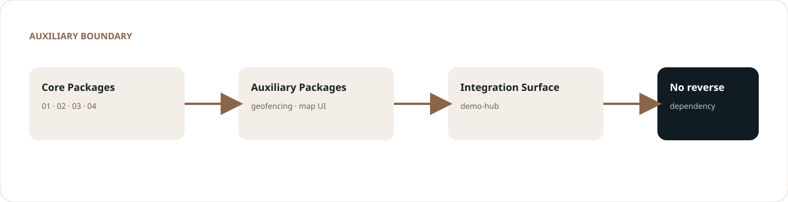

# 📚 Other Modules

<p align="center">
  
</p>

<p align="right">
  <strong>繁體中文</strong> · <a href="./README.en.md">English</a> ·
  <a href="../README.md">專案首頁</a>
</p>

<p>
  <kbd>Auxiliary</kbd>
  <kbd>Optional UI</kbd>
  <kbd>Integration Demo</kbd>
  <kbd>Apache-2.0</kbd>
</p>

## 🧭 目錄

- [包含內容](#包含內容)
- [核心在哪裡](#四個核心在哪裡)
- [依賴規則](#依賴規則)
- [Demo Hub](#demo-hub)
- [Development Workflow](#development-workflow)
- [Testing](#testing-strategy)
- [FAQ](#faq)
- [Security](#security-review)
- [License](#license)

> **所有非四大核心功能的輔助模組集中在這裡，核心 modules 不可反向依賴此資料夾。**

## 📚 包含內容

<p align="center">
  
</p>

| Folder | 功能 | 核心？ | 文件 |
| --- | --- | --- | --- |
| `geofencing-engine/` | Haversine、半徑搜尋、最近站點 | 否 | [中文](./geofencing-engine/README.md) · [English](./geofencing-engine/README.en.md) |
| `map-viewport-ui/` | Clustering、theme、optional Mapbox adapter | 否 | [中文](./map-viewport-ui/README.md) · [English](./map-viewport-ui/README.en.md) |
| `demo-hub/` | 簡潔整合 UI，觸發四個核心 | 否 | 此總覽 |

## 🧩 四個核心在哪裡？

| Core | Location |
| --- | --- |
| Bus ETA Engine | [`../01-bus-eta-engine/`](../01-bus-eta-engine/README.md) |
| Data Fetcher & Provider Layer | [`../02-data-fetcher-provider-layer/`](../02-data-fetcher-provider-layer/README.md) |
| Smart Transit Search Keyboard | [`../03-smart-transit-search-keyboard/`](../03-smart-transit-search-keyboard/README.md) |
| Transit Navigation | [`../04-transit-navigation/`](../04-transit-navigation/README.md) |

## 🔒 依賴規則

- `geofencing-engine` 可依賴 `02`。
- `map-viewport-ui` 可依賴 `02`。
- `demo-hub` 可依賴全部核心 packages。
- 核心 package 不可 import `other-modules`。
- UI 保持功能優先。

## 🎬 Demo Hub

`demo-hub` 顯示：

1. 四段 provider-first system animation。
2. Provider counts 及 TTL cache。
3. Downstream ETA。
4. Search suggestions 及 dynamic keypad。
5. Journey legs。

```powershell
npm run dev
```

## ➕ 新增輔助 Module

1. 建立獨立 package。
2. 加入 workspace。
3. 保持核心依賴方向。
4. 加入 README、AGENTS、tests。
5. 在 root verify script 加入 build／test。

## 🔒 安全邊界

- 無 real endpoints、tokens、cookies、headers、private domains。
- Demo 只用 fictional data。
- 不加入 remote tile 或 map style URL。

## 🤖 AI 協作

閱讀 [AGENTS.md](./AGENTS.md)。

## 🧭 如何選擇輔助 Module

| 需求 | 選擇 |
| --- | --- |
| 只要距離／最近站點 | Geofencing Engine |
| 需要將站點顯示在地圖 | Map Viewport UI |
| 想一次操作四個核心 | Demo Hub |
| 需要新的 utilities | 在此建立新 standalone package |

## 🌐 為何集中到 other-modules？

核心 modules 的版本與測試節奏應保持一致；輔助功能則可能包括 UI、distance utilities、demo 或其他 integration helpers。集中之後，root README 與 AI Agent 都能清楚知道哪些功能不是核心 contract。

## 📊 模組成熟度

| Module | Tests | Default network | Standalone |
| --- | --- | --- | --- |
| Geofencing | Yes | None | Yes |
| Map UI | Yes | None | Yes |
| Demo Hub | Build-tested | None | Integration only |

## 🔁 Development Workflow

1. 建立 folder 及 package。
2. 加入 root `workspaces`。
3. 只在需要時依賴 `02`。
4. 加入 tests、README、AGENTS。
5. 更新 `scripts/verify.mjs`。
6. 執行 `npm run verify`。

## ✅ Testing Strategy

- Pure utilities 使用 unit tests。
- UI logic 將 projection、clustering、theme 拆成 pure functions。
- Demo Hub 以 Vite build 驗證 integration。
- 所有 tests 使用 fictional data。

## 🔒 Security Review

- 不接受 real map tile URL。
- 不接受 production API payload。
- 不把 token 放入 source。
- 不建立 scrape helper。
- 不引入 remote telemetry。

## ❓ FAQ

### Auxiliary module 可否被核心引用？

不可以。若功能成為核心依賴，應升級為正式 foundation，而不是留在 `other-modules`。

### Demo Hub 是否 production UI？

不是，只用作 smoke test 及功能展示。

### Map UI 是否必要？

不是。所有核心功能均可在沒有 Mapbox 或 map UI 下運作。

## 📄 License

Apache-2.0，詳見 [LICENSE](../LICENSE)。

---

<p align="center"><a href="#">Back to top</a></p>
