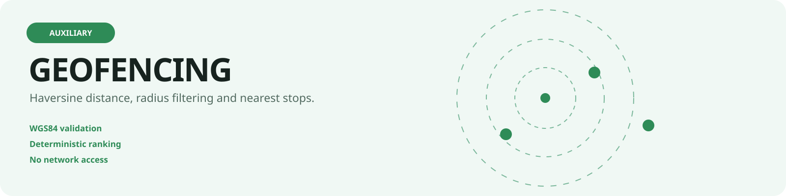

# 📍 Geofencing Engine

<p align="center">
  
</p>

<p align="right">
  <a href="./README.md">繁體中文</a> · <strong>English</strong> ·
  <a href="../README.en.md">Other Modules</a>
</p>

<p>
  <kbd>Auxiliary</kbd>
  <kbd>Haversine</kbd>
  <kbd>Nearby Stops</kbd>
  <kbd>Apache-2.0</kbd>
</p>

## 🧭 Contents

- [Features](#features)
- [Quick Start](#quick-start)
- [Example](#example)
- [Use Cases](#use-cases)
- [API Details](#api-details)
- [Performance](#performance)
- [Tests](#tests)
- [Troubleshooting](#troubleshooting)
- [FAQ](#faq)
- [License](#license)

> **Calculate WGS84 distance, find stops inside a radius, and select the nearest stop for each route.**

## ✨ Features

The package validates coordinates, computes Haversine distance, sorts nearby stops deterministically, and can deduplicate candidates by route.

## 🚀 Quick Start

```powershell
npm run build -w @onedirect/geofencing-engine
npm run test -w @onedirect/geofencing-engine
```

## 🧵 Example

```ts
import { MockDataProvider } from "@onedirect/data-fetcher-provider-layer";
import { findNearbyStops } from "@onedirect/geofencing-engine";

const nearby = await findNearbyStops(
  new MockDataProvider(),
  { lat: 22.1512, lng: 113.5488 },
  { radiusMeters: 750 },
);
```

## API

| Export | Purpose |
| --- | --- |
| `distanceInMeters` | Spherical distance |
| `isCoordinate` | Coordinate type guard |
| `assertCoordinate` | Coordinate validation |
| `findNearbyStops` | Radius search |
| `findNearestStopPerRoute` | Route-aware deduplication |

## 🔌 Custom DataProvider

Only `getStops()` is required. The host application maps its own backend into `TransitStop[]`; no endpoint or credential belongs in this package.

## ✅ Tests

Coverage includes zero distance, a known latitude distance, invalid coordinates, radius filtering, and nearest stop per route.

## 🔒 Security

Fixtures remain fictional. Do not log user coordinates.

## 🤖 AI Collaboration

Read [AGENTS.md](./AGENTS.md).

## 🌐 Use Cases

- Find stops within a GPS radius.
- Show one nearest stop per route.
- Filter access stops before navigation.
- Sort stations by distance in a map UI.

## 📐 Haversine Formula

The implementation uses the standard haversine form, a fixed Earth radius, and clamps the haversine value to the valid `0..1` range before `asin`.

## 🔌 API Details

`distanceInMeters` validates coordinates and returns meters. `findNearbyStops` supports a route filter and bounded result count. `findNearestStopPerRoute` deduplicates candidates by route.

## ⚡ Performance

Runtime is linear in the number of stops and route memberships. A host can introduce a spatial index later without changing the output contract.

## 🧯 Troubleshooting

### Every distance is Infinity

Check for non-finite or out-of-range coordinates.

### A route is missing

Confirm the provider populated `routeIds`.

### Radius boundary is unstable

Use tolerance-aware tests for floating-point distance.

## ❓ FAQ

### Does it support polygons?

No. This package focuses on radius search.

### Does it calculate walking routes?

No. It calculates geographic distance only.

### Does it cache provider data?

No. Cache belongs to the provider layer.

## 📄 License

Apache-2.0. See [LICENSE](../../LICENSE).

---

<p align="center"><a href="#">Back to top</a></p>
