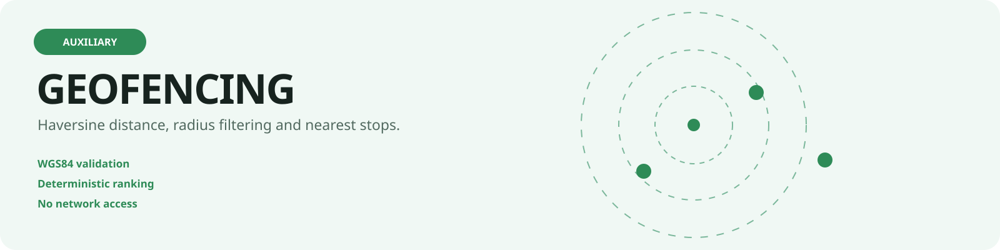

# Geofencing Engine

<p align="center">
  
</p>

<p>
  <kbd>Auxiliary</kbd>
  <kbd>Haversine</kbd>
  <kbd>Nearby Stops</kbd>
</p>

> **計算 coordinate 距離、半徑內站點，以及每條路線最近的一站。**

此 module 屬 `other-modules`，不是四個核心功能之一。Navigator 與 Search 不應依賴它來維持核心 standalone 邊界。

## API

| Export | 用途 |
| --- | --- |
| `distanceInMeters` | Haversine distance |
| `isCoordinate` | WGS84 type guard |
| `assertCoordinate` | Coordinate validation |
| `findNearbyStops` | Radius filtering and sorting |
| `findNearestStopPerRoute` | Route-aware closest stop |

## 使用

```ts
import { MockDataProvider } from "@onedirect/data-fetcher-provider-layer";
import { findNearbyStops } from "@onedirect/geofencing-engine";

const provider = new MockDataProvider();
const stops = await findNearbyStops(
  provider,
  { lat: 22.1512, lng: 113.5488 },
  { radiusMeters: 750 },
);
```

## 開發

```powershell
npm run build -w @onedirect/geofencing-engine
npm run test -w @onedirect/geofencing-engine
```

> 不得加入真實 endpoint、瀏覽器抓取、token、request headers 或 production coordinates。

AI 修改前請閱讀 [`AGENTS.md`](./AGENTS.md)。
