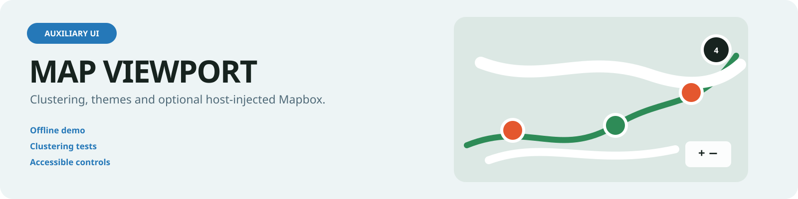

# 🗺️ Map Viewport UI

<p align="center">
  
</p>

<p align="right">
  <a href="./README.md">繁體中文</a> · <strong>English</strong> ·
  <a href="../README.en.md">Other Modules</a>
</p>

<p>
  <kbd>Auxiliary</kbd>
  <kbd>React 18</kbd>
  <kbd>Clustering</kbd>
  <kbd>Light / Dark</kbd>
  <kbd>Apache-2.0</kbd>
</p>

## 🧭 Contents

- [Features](#features)
- [Quick Start](#quick-start)
- [React Example](#react-example)
- [UI Details](#ui-details)
- [Mapbox](#mapbox-adapter)
- [Accessibility](#accessibility)
- [Responsive Verification](#responsive-verification)
- [Troubleshooting](#troubleshooting)
- [FAQ](#faq)
- [License](#license)

> **An optional transit viewport with clustering, themes, pan, zoom, and station details. Core modules do not depend on this UI.**

## ✨ Features

The viewport provides deterministic zoom-aware clustering, pointer panning, map controls, light and dark themes, a station detail sheet, and a host-injected Mapbox adapter.

## 🚀 Quick Start

```powershell
npm run build -w @onedirect/map-viewport-ui
npm run test -w @onedirect/map-viewport-ui
```

## ⚛️ React Example

```tsx
import { MockDataProvider } from "@onedirect/data-fetcher-provider-layer";
import { MapViewport } from "@onedirect/map-viewport-ui";
import "@onedirect/map-viewport-ui/styles.css";

export function Screen() {
  return <MapViewport provider={new MockDataProvider()} />;
}
```

## ⚙️ Pure Functions

The package exports bounds calculation, coordinate projection, clustering, and theme-token helpers.

## Mapbox Integration

The host supplies the SDK, container, token, and style identifiers. The default demo remains offline.

## 🔌 Custom DataProvider

Override stop and LRT loading in the host provider. The UI package must not own server secrets.

## ✅ Tests

Coverage includes projection, low-zoom clustering, high-zoom separation, and theme token differences.

## 🔒 Security

- No real tile endpoint or style URL.
- No server secrets in public frontend variables.
- All station fixtures are fictional.

## 🤖 AI Collaboration

Read [AGENTS.md](./AGENTS.md).

## 🎨 UI Details

- Markers use stable dimensions to avoid layout jumps.
- Map pan and marker clicks are handled separately.
- Theme is driven by CSS variables and token objects.
- The detail sheet is measured to avoid overlapping controls.
- Mobile layouts must not create horizontal page overflow.

## 🧩 Component API

The component accepts a provider, initial theme, stop-selection callback, and optional class name.

## Mapbox Adapter

The adapter accepts a host-supplied SDK, container, token, style identifiers, and center point. The package does not persist credentials or endpoints.

## ♿ Accessibility

Map controls have labels and titles. Markers use button semantics. Selected and disabled states cannot rely on color alone.

## 📱 Responsive Verification

The viewport is checked at desktop and mobile sizes, with zero horizontal overflow and zero clipped markers.

## 🧯 Troubleshooting

### Marker click does not open the sheet

Ensure pointer capture does not swallow button events.

### The map is blank

The default mock viewport is offline. If using Mapbox, check host-injected styles and tokens.

### Controls overlap the detail sheet

Use the measured sheet height to offset controls.

## ❓ FAQ

### Is React required?

The UI component is React, but clustering and projection helpers are framework-independent.

### Does it include real tiles?

No. The default demo is fully offline.

### Can I use MapLibre?

Yes. Implement another adapter against the same data contracts.

## 📄 License

Apache-2.0. See [LICENSE](../../LICENSE).

---

<p align="center"><a href="#">Back to top</a></p>
