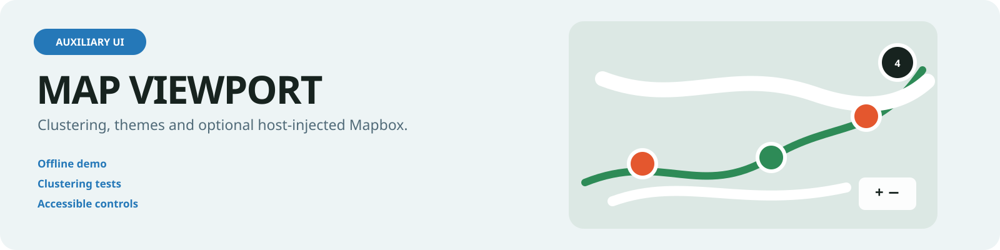

# 🗺️ Map Viewport UI

<p align="center">
  
</p>

<p align="right">
  <strong>繁體中文</strong> · <a href="./README.en.md">English</a> ·
  <a href="../README.md">Other Modules</a>
</p>

<p>
  <kbd>Auxiliary</kbd>
  <kbd>React 18</kbd>
  <kbd>Clustering</kbd>
  <kbd>Light / Dark</kbd>
  <kbd>Apache-2.0</kbd>
</p>

## 🧭 目錄

- [功能](#功能)
- [Quick Start](#quick-start)
- [React Example](#react-example)
- [UI Details](#ui-功能細節)
- [Mapbox](#mapbox)
- [Accessibility](#accessibility)
- [Responsive Checks](#responsive-checks)
- [Troubleshooting](#troubleshooting)
- [FAQ](#faq)
- [License](#license)

> **可選的 transit viewport：clustering、theme、pan、zoom 與 detail sheet。核心功能不依賴此 UI。**

## ✨ 功能

| Capability | Description |
| --- | --- |
| Station clustering | Zoom-aware deterministic grouping |
| Pointer pan | Drag the map surface |
| Zoom controls | In、out、reset |
| Theme | Light／dark tokens |
| Detail sheet | Stop code、name、route chips |
| Mapbox adapter | Host-injected SDK and style |

## 🚀 Quick Start

```powershell
npm run build -w @onedirect/map-viewport-ui
npm run test -w @onedirect/map-viewport-ui
```

## ⚛️ React Example

```tsx
import { MockDataProvider } from "@onedirect/data-fetcher-provider-layer";
import { MapViewport } from "@onedirect/map-viewport-ui";
import "@onedirect/map-viewport-ui/styles.css";

export function Screen() {
  return (
    <MapViewport
      provider={new MockDataProvider()}
      initialTheme="light"
    />
  );
}
```

## ⚙️ Pure Functions

| Export | Purpose |
| --- | --- |
| `calculateBounds` | Pad geographic bounds |
| `projectCoordinate` | Convert coordinate to pixels |
| `clusterMapPoints` | Create clusters |
| `getMapThemeTokens` | Return theme colors |

## 🔌 Mapbox

`mountMapboxAdapter()` accepts SDK、container、token、light style、dark style。The default demo remains fully offline.

## 🔌 Custom DataProvider

Override stop and LRT loading through a host provider. The package must not read environment secrets directly.

## ✅ Tests

- Projection inside viewport。
- Low-zoom clustering。
- High-zoom separation。
- Distinct light／dark tokens。

## 🔒 Security

- No real tile endpoint or style URL。
- No server secrets in `VITE_*` variables。
- Mock station data remains fictional。

## 🤖 AI Collaboration

Read [AGENTS.md](./AGENTS.md).

## 🎨 UI 功能細節

- Markers 使用固定尺寸，避免 cluster 轉單點時跳動。
- Pan 與 button click 分開處理，避免 pointer capture 吞掉 marker click。
- Theme 由 CSS variables 及 token object 控制。
- Detail sheet 會量測高度，避免與 controls／legend 重疊。
- Mobile viewport 避免水平 overflow。

## 🧩 Component API

```tsx
<MapViewport
  provider={provider}
  initialTheme="dark"
  onStopSelect={(stop) => console.log(stop)}
/>
```

## 🔌 Mapbox Adapter Contract

```ts
mountMapboxAdapter({
  sdk,
  container,
  accessToken,
  styleLight,
  styleDark,
  center,
});
```

Adapter 只接受 host 提供的 SDK 及 config；package 不保存 secret 或 style URL。

## ♿ Accessibility

- Map buttons 有 `aria-label` 及 `title`。
- Marker 使用 button semantics。
- Disabled 或 selected state 不應只靠顏色。
- Detail sheet 的 close button 必須可 keyboard 操作。

## 📱 Responsive Checks

| Viewport | Verified |
| --- | ---: |
| Desktop 1440×900 | Yes |
| Mobile 390×844 | Yes |
| Body horizontal overflow | 0 |
| Marker clipping | 0 |

## 🧯 Troubleshooting

### Marker click 不開 detail sheet

確認 pointerdown 不會 capture button event。

### 地圖空白

Default mock viewport 不依賴 Mapbox；若使用 adapter，檢查 style 及 token injection。

### Control 與 sheet 重疊

使用 measured sheet height 調整 controls bottom offset。

## ❓ FAQ

### 可否不使用 React？

目前 package 是 React component；projection／clustering pure functions 仍可獨立使用。

### 是否包含真實圖磚？

不包含。Default demo 完全 offline。

### 可否換成 MapLibre？

可以，透過 adapter boundary 或以相同 data contracts 實作不同 viewport。

## 📄 License

Apache-2.0. See [LICENSE](../../LICENSE).

---

<p align="center"><a href="#">Back to top</a></p>
